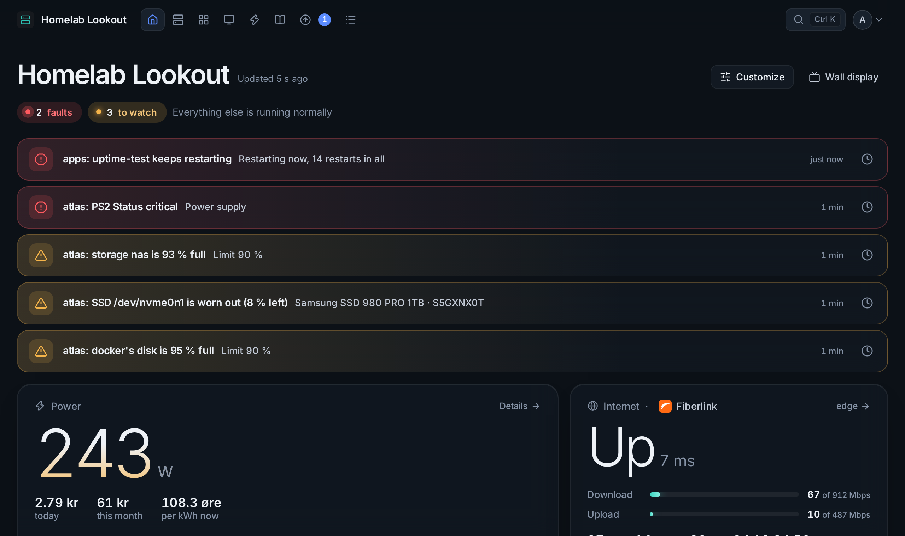
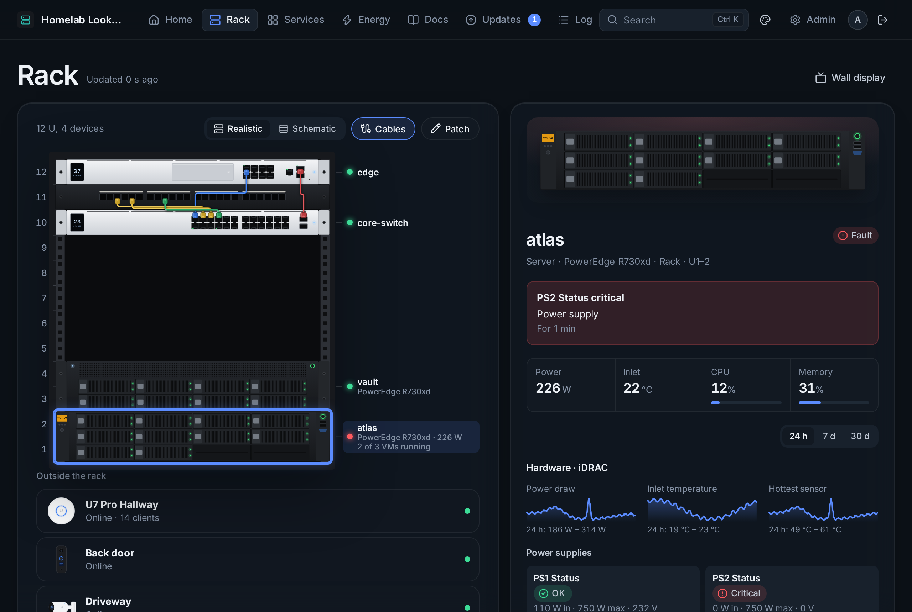
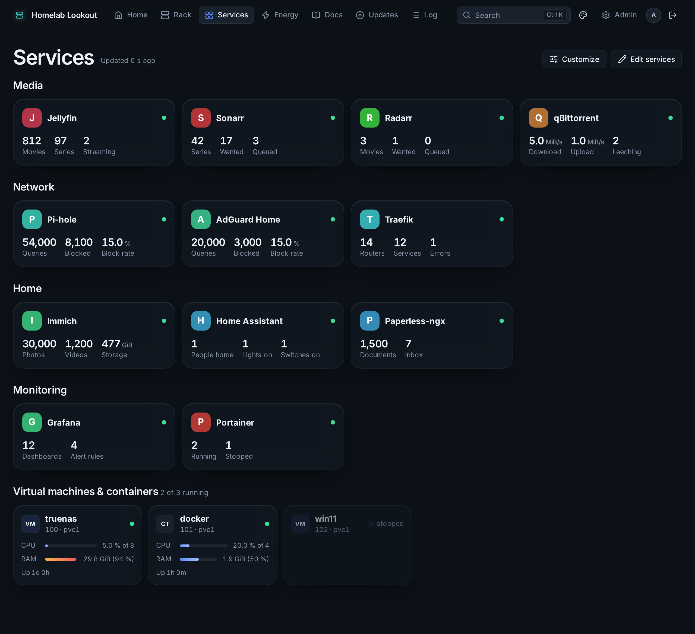
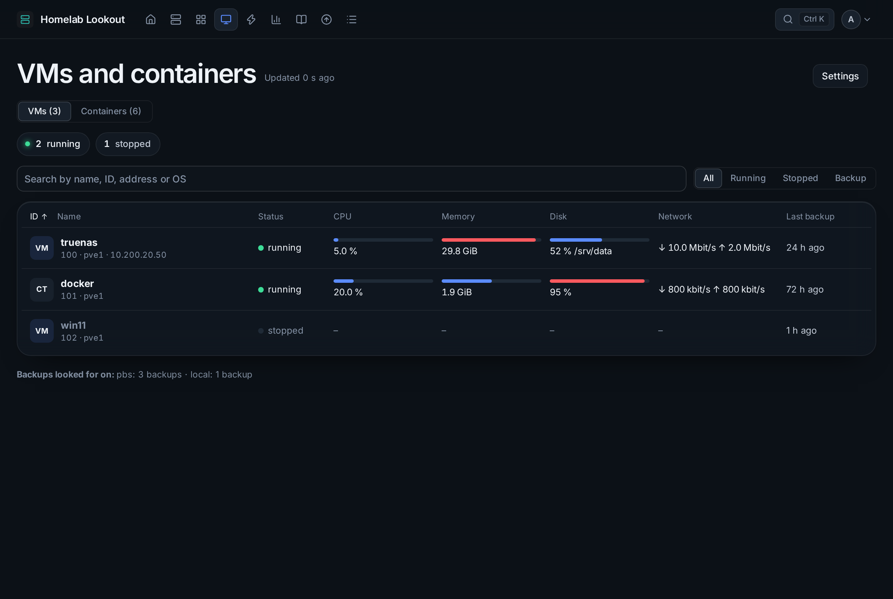
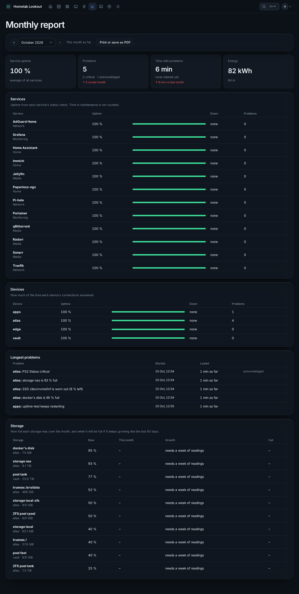
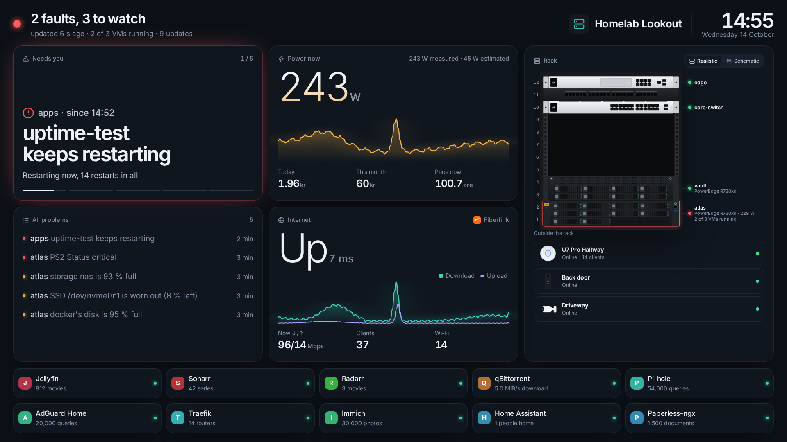
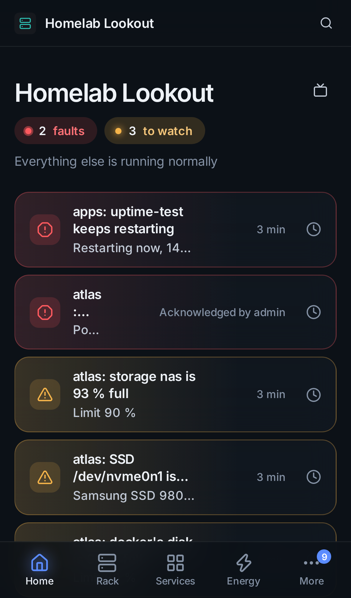

# Homelab Lookout

**Your servers, network, power and services on one calm screen.**

Homelab Lookout reads your equipment and shows how it is doing: hardware health from the management controllers, Proxmox VMs and containers, NAS pools, the network, UPSes, smart plugs, your self-hosted apps, and what it all costs in power. It alerts you when something needs you, keeps a history, and never changes anything on a device.



It is one Node.js file and a folder of static pages, with **no npm dependencies**. It runs on a small VM or a Raspberry Pi.

> All names, addresses and numbers in this repository and its screenshots are sample data.

---

## What it does

<table>
<tr>
<td width="50%" valign="top">

**See everything**
- **Home**: what needs you, power now and its cost, the internet, every device
- **Rack** drawn to scale with live lights, drives and patch cables
- **Services** with live status and the numbers that matter (34 integrations)
- **VMs and containers** from Proxmox, Docker and Portainer, with backups
- **Wall display** for a tablet or TV

</td>
<td width="50%" valign="top">

**Know when something is wrong**
- **Alerts** to the installed app (push), ntfy, Telegram, Discord, e-mail, iMessage or a webhook
- **Incidents** with *Acknowledge* from the message itself
- **Check-ins** for backups and cron jobs, **maintenance windows**
- A storage **forecast** that warns before a disk is full
- A **monthly report** of uptime, problems and cost
- **Undo** any change in Admin, or go back to how it was

</td>
</tr>
</table>

| | |
|---|---|
|  |  |
| **Rack**: fronts modelled on the real hardware, drives and ports lit live | **Services**: grouped cards with status and numbers from each app |
|  |  |
| **VMs**: CPU, memory, disk, network and the last backup of every guest | **Report**: uptime, problems, energy and storage growth per month |
|  |  |
| **Wall display**: one screen readable across the room | **On a phone**: installable as an app, with push notifications |

## What it reads

| | |
|---|---|
| **Servers** | Redfish: Dell iDRAC, HPE iLO, Lenovo XClarity, Supermicro (power, PSUs, fans, temperatures, drives) |
| **Virtualisation** | Proxmox VE (nodes, VMs, containers, storage, ZFS, SMART, backups), Docker (socket proxy), Portainer |
| **Storage** | TrueNAS 25.04+, Synology DSM, QNAP and others over SNMPv3 |
| **Network** | UniFi (and Protect cameras), TP-Link Omada, any SNMPv3 switch or router |
| **Power** | UPSes over NUT or SNMP, Shelly and Tasmota plugs, Home Assistant power sensors; electricity prices for Norway (spot or Norgespris, plus grid tariff) |
| **Inside machines** | The **Lookout agent**: a small shell script for any Linux machine (memory as Linux counts it, filesystems, systemd services, pending updates) |
| **Anything else** | Ping, TCP port, DNS lookup and web page checks; a custom JSON API card |

Read-only accounts are enough everywhere, and passwords are stored encrypted and never sent back to the browser.

## Quick start

On a Debian or Ubuntu machine with a private address:

```sh
git clone https://github.com/<you>/homelab-lookout.git
cd homelab-lookout
sudo sh deploy/install.sh --host 192.168.1.20
```

The installer sets up Node.js, a dedicated system user, an encryption key, a local certificate authority and a systemd service, and asks for the admin password. Then open **https://192.168.1.20:8443**, trust the certificate (the page explains how), and add your first device under **Admin → Devices**, or let **Find devices** look for them.

→ [Installation in detail](docs/getting-started/installation.md)

## Documentation

| Getting started | Features | Configuration |
|---|---|---|
| [Installation](docs/getting-started/installation.md) | [Home, rack and wall display](docs/features/home-and-wall.md) | [Admin overview](docs/configuration/admin.md) |
| [First steps: sign in, certificate, app](docs/getting-started/first-steps.md) | [Devices and connections](docs/features/devices.md) | [Backups](docs/configuration/backups.md) |
| [Reverse proxy and a domain name](docs/getting-started/reverse-proxy.md) | [Find devices](docs/features/find-devices.md) | [Security](docs/configuration/security.md) |
| [Updating](docs/getting-started/updating.md) | [Services and the status page](docs/features/services.md) | [Troubleshooting](docs/troubleshooting.md) |
| | [VMs and containers](docs/features/vms-and-containers.md) | [Development and tests](docs/development.md) |
| | [Linux agents](docs/features/linux-agents.md) | |
| | [Alerts and incidents](docs/features/alerts.md) | |
| | [Check-ins and maintenance](docs/features/checkins-and-maintenance.md) | |
| | [Power and energy](docs/features/energy.md) | |
| | [History and the monthly report](docs/features/history-and-reports.md) | |
| | [Docs, Updates, Log and undo](docs/features/docs-updates-log.md) | |

There is also an illustrated **user guide (PDF)** with every page explained, served by the dashboard at `/guide.pdf` (source in [docs/guide](docs/guide)).

## Security in short

- Login for everything (an optional public dashboard and status page show no addresses or secrets); passkeys and *keep me signed in* are optional.
- Secrets are encrypted at rest (AES-256-GCM, key outside the app) and write-only in the browser.
- Self-signed device certificates are pinned and checked before any password is sent.
- Strict CSP, CSRF tokens, same-origin checks, lockouts, and a sandboxed systemd unit running as its own user.
- It never changes a device, never installs updates, and the agent never runs commands.

→ [The full security model](docs/configuration/security.md)

## Project layout

```
server.js            the whole server: collectors, alerts, history, API, pages
public/              pages, styles and scripts (no build step), the agent's scripts
deploy/              installer, deploy command, systemd unit, package helper
docs/                this documentation and the PDF guide's source
test/                end-to-end suites with mock devices and services
```

## License

Private project. Third-party licences for the bundled font and icons are in [`public/licenses/`](public/licenses).
