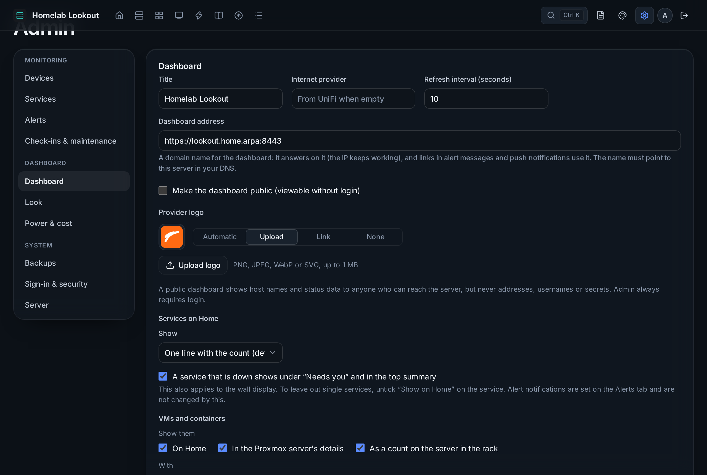
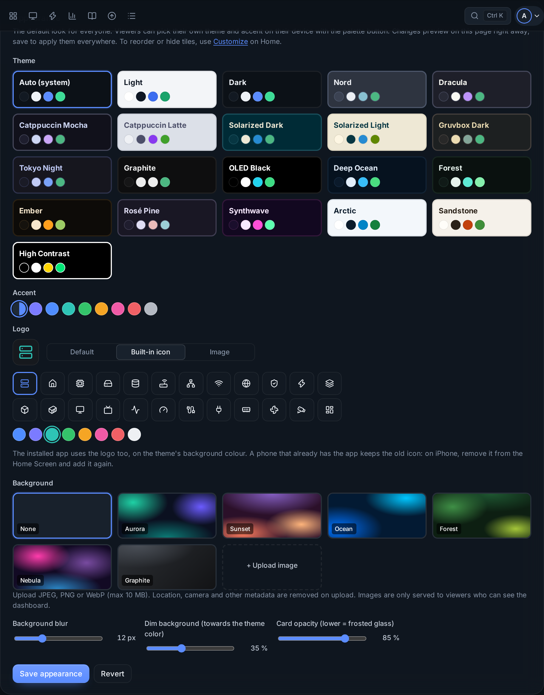
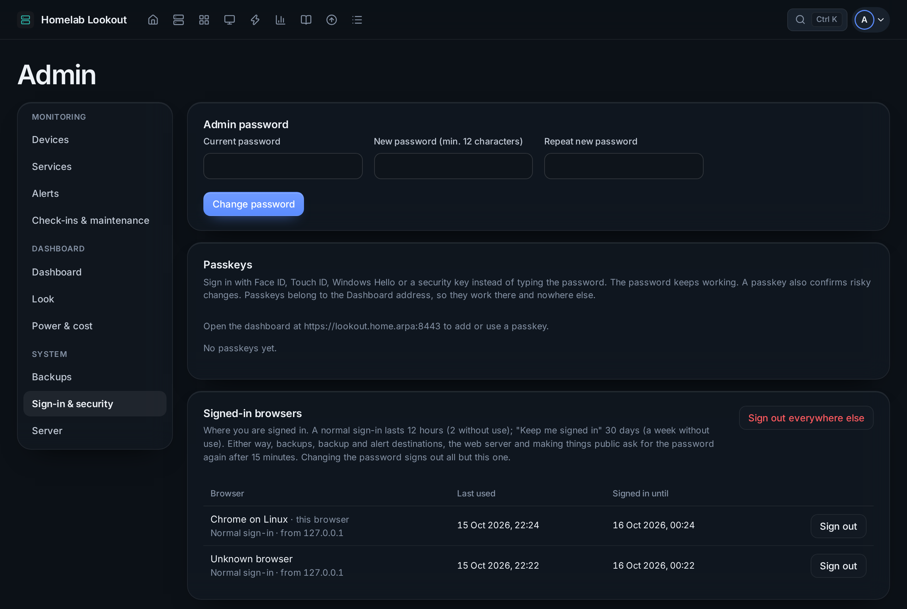
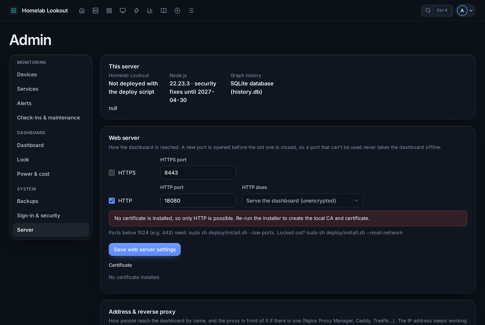

# Admin overview

**Admin** (your avatar → Admin) has ten tabs in three groups. On a phone, the menu at the top switches between them.

| Group | Tab | What's there |
|---|---|---|
| Monitoring | **Devices** | The rack, devices and their connections, [Find devices](../features/find-devices.md), [Linux agents](../features/linux-agents.md) |
| | **Services** | Cards, status checks and integrations ([Services](../features/services.md)) |
| | **Alerts** | Channels and what to send where ([Alerts](../features/alerts.md)) |
| | **Check-ins & maintenance** | [Check-ins and maintenance windows](../features/checkins-and-maintenance.md) |
| Dashboard | **Dashboard** | Title, provider, what shows on Home, VMs, the status page, making it public |
| | **Look** | Theme, accent, logo and app icon, background |
| | **Power & cost** | Prices and tariffs ([Power and energy](../features/energy.md)) |
| System | **Backups** | Download, restore, automatic backups ([Backups](backups.md)) |
| | **Sign-in & security** | Password, passkeys, signed-in browsers, remembered devices |
| | **Server** | This server, the web server and certificate, address & reverse proxy |

Passwords, tokens and keys are entered only here, stored encrypted and never shown again.

## Dashboard

- **Title**, **internet provider** (empty uses the name the UniFi console reports) and **refresh interval**.
- **Provider logo**: *Automatic* looks up who owns your public IP in the internet registry and uses that company's icon; or upload one, paste a link, or none.
- **Services on Home**: one line with the count (default), tiles, a compact list, only the ones that are down, or off. Untick *A service that is down shows under "Needs you"* to keep services out of Home's problems.
- **VMs and containers**: where they show (Home, the Proxmox server's details, a count on the server in the rack) and with which numbers.
- **Status page**: switch on the public `/status` page.
- **Make the dashboard public**: shows Home, the rack and services to anyone who can reach it (never addresses, secrets or versions). Keep it off and share the status page instead.

## Look

- **Theme** (21, including Auto, Nord, Dracula, Catppuccin, Solarized, Gruvbox, Tokyo Night, OLED Black for wall screens, High Contrast) and **accent**: the default for everyone. Each viewer can still pick their own on their device.
- **Logo**: the default, a built-in icon in one of eight colours, or your own image (PNG, JPEG, WebP or SVG). It shows in the top bar, on the sign-in page and as the browser tab icon.
- **App icon**: drawn from the logo on the theme's colour when you press Save. A phone that already has the app keeps its old icon: on iPhone, remove the app and add it again.
- **Background**: six built-in gradients or your own image, with blur, dimming and card opacity.

## Sign-in & security

- **Admin password**: changing it signs out every other browser and remembered device.
- **Passkeys**: see [First steps](../getting-started/first-steps.md#passkeys).
- **Signed-in browsers**: where you are signed in (normal or kept signed in), with last use and address; **Sign out** or **Sign out everywhere else**.
- **Remembered devices**: the view-only devices, with **Sign out** for each.

## Server

- **This server**: the running version, Node.js and when its security fixes end, where the history is stored.
- **Web server**: HTTPS and HTTP ports; keep HTTP on *Redirect to HTTPS*. **Certificate** shows the names it covers, when it expires and the CA fingerprint, with **Download CA certificate**. Ports below 1024 need `install.sh --low-ports`.
- **Address & reverse proxy**: the dashboard's domain name, your reverse proxies, what the server sees of your connection, and setup instructions for each proxy. See [Reverse proxy](../getting-started/reverse-proxy.md).
- **Install as an app**: the steps for phones and PCs.

Risky changes on these tabs ask for the password again if it wasn't typed in the last 15 minutes.
