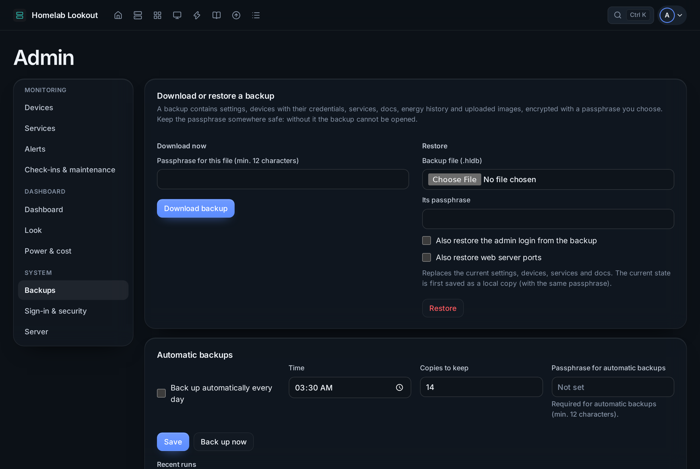

# Backups



**Admin → Backups**. Changes here ask for the password if it wasn't typed in the last 15 minutes.

## Download and restore

- **Download now** gives one encrypted `.hldb` file with *everything*: settings, devices and their passwords, services, alert channels, check-ins, agents, docs, energy and graph history, incidents, the Log and uploaded images. Choose a passphrase of at least 12 characters and keep it in your password manager; without it the file can't be opened.
- **Restore** reads such a file. The current state is saved as a local copy first. The admin login and the web server ports are only restored if you tick them.

How it is protected: secrets are decrypted with the server key and travel inside the passphrase-encrypted file (scrypt + AES-256-GCM). A backup therefore restores on a fresh install with a new server key, and the server key itself never leaves the server. A restored file is checked again as if everything were entered now: what doesn't pass is left out.

## Automatic backups

A daily time, how many copies to keep, and a passphrase. Copies are kept on the server, and also go to each **destination**:

| Destination | Set up |
|---|---|
| **Folder** | Mount a NAS share (NFS or SMB) on `/var/backups/homelab-dashboard`, the only path outside its data the service can write. Admin shows example `/etc/fstab` lines |
| **S3-compatible** | Backblaze B2, Wasabi, Cloudflare R2, MinIO, AWS; AWS Signature V4 over HTTPS, optional certificate pinning |
| **rsync over SSH** | Save the destination, **Generate SSH key**, add the public key to the target's `authorized_keys`, then **Fetch host key → Trust this host key → Test**. The host key is pinned; a different key is refused |

Example `/etc/fstab` line for an NFS share:

```
192.168.1.40:/volume1/backups  /var/backups/homelab-dashboard  nfs  defaults,_netdev  0 0
```

**Local copies** on the server can be downloaded, restored or deleted. A failed automatic backup raises a *Backup failed* alert.

The app never runs custom commands, only the fixed `rsync`, `ssh` and `ssh-keygen` with checked arguments.

## Moving to a new server

1. **Download now** on the old server.
2. Install Homelab Lookout on the new machine.
3. **Restore** the file there, ticking *Also restore the admin login* if you want the same password.

Devices keep their passwords, since they travel inside the encrypted backup. Import the new server's CA on your devices (or use a [reverse proxy](../getting-started/reverse-proxy.md) with a public certificate). Linux agents point at the old address; change `URL` in their `agent.conf` if it moved. Passkeys keep working if the dashboard address stays the same.
