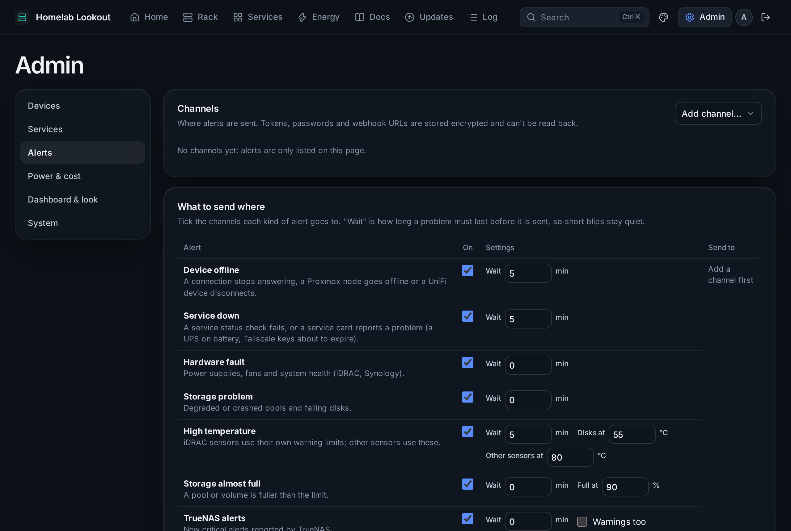
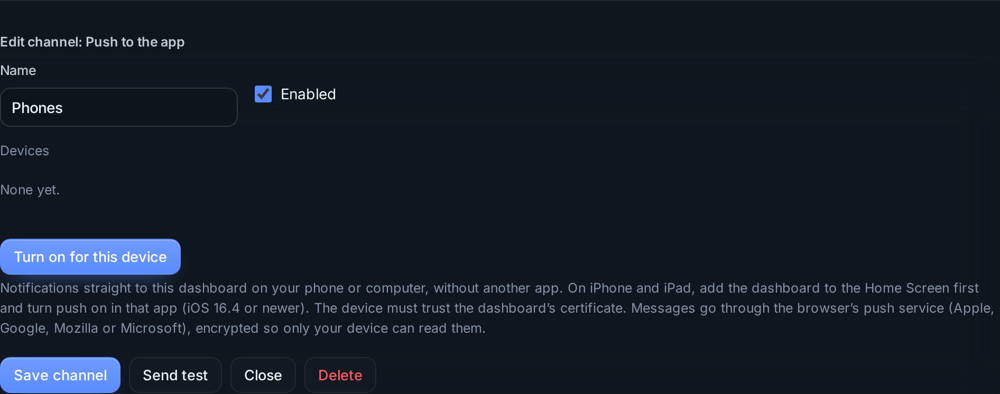
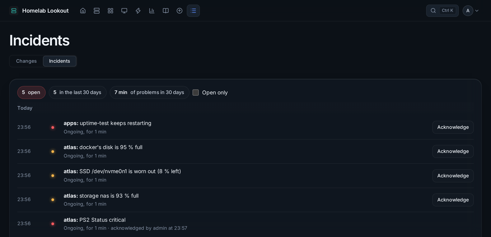

# Alerts and incidents



## Channels

**Admin → Alerts → Channels**: where messages go. Add as many as you like and press **Send test**.

| Channel | You need |
|---|---|
| **Push to the app** | Nothing else: notifications straight to the installed dashboard (below) |
| **ntfy** | A server (ntfy.sh or your own), a long random topic, and a token if needed |
| **Telegram** | A bot token and a chat ID (*How to get a bot token and chat ID* explains it) |
| **Discord** | A webhook URL |
| **E-mail** | An SMTP server with TLS or STARTTLS (a login is never sent unencrypted), user, password, from and to |
| **iMessage (Sendblue)** | Sendblue API key ID and secret, your Sendblue line, and up to 10 numbers (SMS where a phone has no iMessage) |
| **Webhook** | Any URL that takes a JSON POST: Home Assistant, n8n, Node-RED, your own script |

Tokens, passwords and webhook URLs are encrypted and write-only, and bound to where they are sent.

### Push to the app



1. Add a **Push to the app** channel and save it.
2. On each phone, tablet or computer, open the channel and press **Turn on for this device**; allow notifications.
3. On iPhone and iPad, install the app on the Home Screen first and do it inside the app (iOS 16.4 or newer).

Messages go through the browser maker's push service (Apple, Google, Mozilla, Microsoft), encrypted so only your device can read them. A critical alert stays on screen; one open problem has an **Acknowledge** button. A device that turned notifications off is removed by itself.

### Webhook

Each alert is a JSON POST:

```json
{
  "source": "homelab-lookout",
  "site": "My Lab",
  "severity": "critical",
  "title": "atlas: PS2 Status critical",
  "text": "Power supply",
  "link": "https://lookout.example.com",
  "ackUrl": "https://lookout.example.com/ack/0123456789abcdef?t=…",
  "alerts": [{ "type": "hardware", "event": "fired", "severity": "critical", "title": "…", "detail": "…", "since": "2026-10-15T08:00:00.000Z" }],
  "sentAt": "2026-10-15T08:00:05.000Z"
}
```

The URL is stored like a password (its path is often the secret); only the server part is shown.

## What to send where

One row per kind of alert, with its channels and a **wait** time so short blips stay quiet:

| Alert | When |
|---|---|
| Device offline | A connection stops answering, a Proxmox node goes offline, a UniFi device disconnects, an agent stops reporting |
| Service down | A status check fails, a card reports a problem, a certificate is about to expire |
| Hardware fault | Power supplies, fans, system health, UPS on battery |
| Storage problem | Degraded pools, failing or worn-out disks |
| High temperature | Sensors over their limit |
| Storage almost full | Over the limit, or full within 30 days at its pace |
| TrueNAS alerts | New critical (or warning) alerts from TrueNAS |
| High power draw | The total stays above a limit (off by default) |
| Container problem | Restarting, stopped, unhealthy |
| Linux machine (agent) | Failed or stopped services, security updates, reboot needed |
| Check-in missed | A job didn't check in, or reported a failure |
| Backup failed | The dashboard's own backup, a Proxmox backup job, or a VM without a recent backup |

Also: **send a message when it clears**, and **remind while still active** (every 1, 4, 12 or 24 hours). Several alerts at once go out as one message; at most 30 messages per channel per hour. **Active now** and **Recent notifications** show what is going on.

Per device and per service you can **mute** alerts and set **own limits**: see [Devices](devices.md#alerts-for-this-device).

## Acknowledge

Acknowledging means someone is on it: the problem keeps showing until it clears, but no more reminders are sent.

- **From the message**: a button in push and ntfy, a link in Telegram, iMessage, e-mail and Discord, and `ackUrl` in a webhook. The link opens a page that asks first (so a link preview can't acknowledge anything) and only works for that one problem.
- **On Home**: the clock button on the row → **Acknowledge**.

Links point to the **Dashboard address** (Admin → Server), so set it to an address your phone can reach. See [Reverse proxy](../getting-started/reverse-proxy.md).

## Incidents



**Log → Incidents** lists every problem from when it appeared to when it cleared: how long it lasted, who acknowledged it and when, and whether it was behind another outage or in maintenance. **Open only** shows the ones still going on. At the top: how many are open, how many in the last 30 days, and how long they lasted in total (muted ones left out). Incidents are kept for a year and are part of backups.
