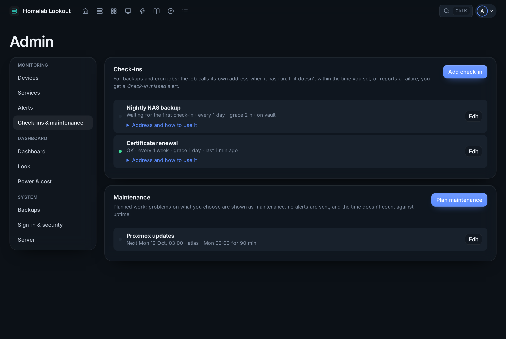

# Check-ins and maintenance



## Check-ins

A check-in catches the backup or cron job that silently stopped running, which no other check can see.

1. **Admin → Check-ins & maintenance → Add check-in**: a name, how often the job runs (**Expected every**), how late it may be (**Grace time**), and optionally the device it runs on.
2. Open **Address and how to use it** and add the address to the end of the job, for example in crontab:

```sh
0 3 * * * /usr/local/bin/backup.sh && curl -fsS -m 10 --retry 3 http://192.168.1.20:8080/ping/<token> \
          || curl -fsS -m 10 --retry 3 http://192.168.1.20:8080/ping/<token>/fail
```

| State | |
|---|---|
| **OK** | The job called in time |
| **Late** | Past the period |
| **Missed** | Past the period and the grace time: a *Check-in missed* alert |
| **Failed** | It called `…/fail`: an alert at once |

`…/start` marks the start of a run. The address works over plain HTTP too, so `curl` needs no trusted certificate. Anyone who knows it can check in, so keep it like a password; **Edit → New address** replaces it, **Reset** forgets a missed or failed state.

## Maintenance

**Plan maintenance** for work you know about:

- what it covers: **Everything**, or chosen devices, services and check-ins;
- when: **Starting now** (30 minutes to a day), **Once** (from–to), or **Every week** (days, start time and length).

While it is on, problems on what it covers show on Home as *Maintenance* but don't count as faults, no alerts are sent, and the time doesn't count against uptime. Device tiles and service cards say **Maintenance**. **End now** stops it early (for a weekly window, only this time).

Times are in the dashboard's time zone (Europe/Oslo).
