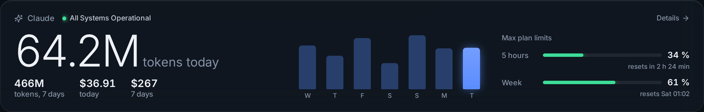
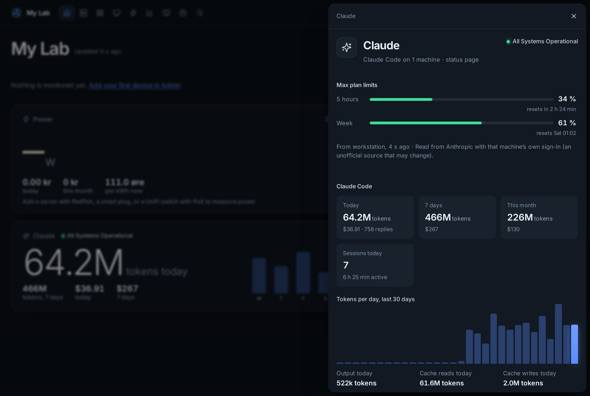
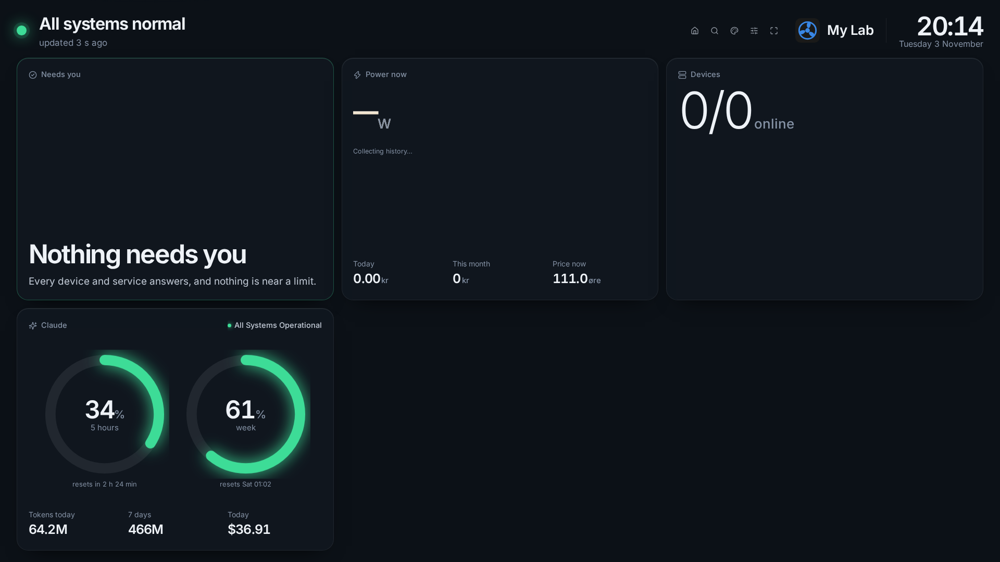

# Claude usage



A **Claude** tile on Home (and a panel on the wall display) shows how much Claude is used: Claude Code's tokens today and over the week, what that would cost at API prices, how much of your plan's limits is used, and whether Claude itself is up. Set it up in **Admin → Dashboard → Claude**; any one of the three sources below is enough, and the tile only appears once one is set up.

| Source | What it gives | What it needs |
|---|---|---|
| **Claude reporter** | Claude Code on that machine: tokens per model and hour (input, output, cache reads and writes), sessions, active time; and, if you tick it, the **plan limits** for the whole account (5 hours and the week, with when they reset, and how the week splits between Claude Code, chats and the rest) | Python 3 and systemd on a Linux machine where you are signed in to Claude Code |
| **Status page** | What [status.claude.com](https://status.claude.com) says: all fine, minor problems or an outage, per part (claude.ai, the API, Claude Code…) and the incidents | Nothing; checked every 5 minutes |
| **API organization** | A Claude Console organization's daily tokens and costs, per model (the Usage and Cost Analytics API) | An **Admin API key** (`sk-ant-admin…`), made by an organization admin under Settings → Admin keys |

## Claude reporter

1. **Admin → Dashboard → Claude → Add reporter**. Give it the machine's name and choose what it reports: **Claude Code tokens**, **Plan limits** (Pro, Max and Ultra plans), or both. With only plan limits it never reads the logs, and the tile shows just the limits.
2. **Create** shows the install command. Run it on the machine **as the user who uses Claude Code**, not with sudo:

```sh
curl -fsS https://lookout.example.com/claude/install.sh | sh -s -- --id <id> --token <token>
```

The command holds the reporter's own token, shown only once. It puts the reporter in `~/.local/bin/lookout-claude`, its settings in `~/.config/lookout-claude/reporter.conf`, and starts a systemd user timer that reports every 5 minutes. To keep it reporting while you are logged out, run once `sudo loginctl enable-linger <user>` (the installer says so when it is needed).

On the machine:

| | |
|---|---|
| `lookout-claude status` | What it last sent, and whether plan limits are on |
| `lookout-claude test` | Send a report now and show the answer |
| `lookout-claude update` | Install the newest reporter from the dashboard (Admin says when there is one) |
| `lookout-claude uninstall` | Remove it; the dashboard marks it as uninstalled. Claude Code's own logs are not touched |

It reads Claude Code's logs in `~/.claude/projects` (or `$CLAUDE_CONFIG_DIR`), only what was added since the last run, and counts each reply once (Claude Code writes a reply once per part). It sends numbers only: **never a prompt, a reply, a file name or a project name**. The last 35 days are sent each time, so the dashboard has them again after a restart.

### Plan limits

The limits are for your **whole Claude account**: every computer, the claude.ai website and apps, and cloud sessions all count. So one reporter anywhere is enough for them, while tokens are only counted on machines with a reporter. Next to the limits, the tile shows how this week's use splits between Claude Code, Chats, Cowork and Other.

With plan limits ticked, the reporter asks Anthropic how much of the 5-hour and weekly limits is used, with the machine's own Claude sign-in (`~/.claude/.credentials.json`). The sign-in is read there and sent only to Anthropic; it never reaches the dashboard, and the reporter never renews it (Claude Code does that the next time it is used; until then the tile says the sign-in has expired). This is the same source Claude Code's `/usage` uses, but it is **not an official API**: it may change or stop without notice. On a Mac the sign-in is kept in the keychain, so plan limits work on Linux only.

## Costs

For Claude Code the cost is an **estimate at API list prices** (cache writes and reads included). On a Pro, Max or Ultra plan you pay the subscription instead, so read it as "what this would cost on the API". The API organization's costs are what Anthropic bills (before credits), per UTC day; Anthropic updates them within a few hours.

## On Home and the wall



Click the tile for the details: the plan limits, today, the week and the month, tokens per day for 30 days, the models with their share and cache hits, each machine, the API organization and the status page's parts and incidents.

**Customize** on Home has *This tile shows*: tokens, cost, sessions and active time, models and cache hits, plan limits, Claude status, and whether the tile is on Home at all. It is the same for everyone.

On the **wall display**, *Claude* is a panel (hidden until you tick it in the wall's Customize) with four styles: **Big number**, **Limit rings** (the 5-hour and weekly limits as two rings), **Full tile** (the number, the week's bars and the limits) and **Ticker line** (one thin row above the services). It has its own choice of what it shows.



## Outages

With the status page on, a major outage shows under **Needs you** (untick *A major outage shows under "Needs you"* to keep it on the tile only). To be notified, switch on the **Claude outage** rule on the Alerts tab.

## Security

- The reporter has its own token (only its hash is kept), and **New token** in Admin replaces it. Reports are checked field by field: only Claude model names, numbers within limits and hours from the last 36 days are kept.
- The Admin API key is checked with Anthropic before it is kept, stored encrypted, never sent back to the browser, and only sent to `api.anthropic.com`.
- Visitors of a public dashboard never see the Claude tile.
