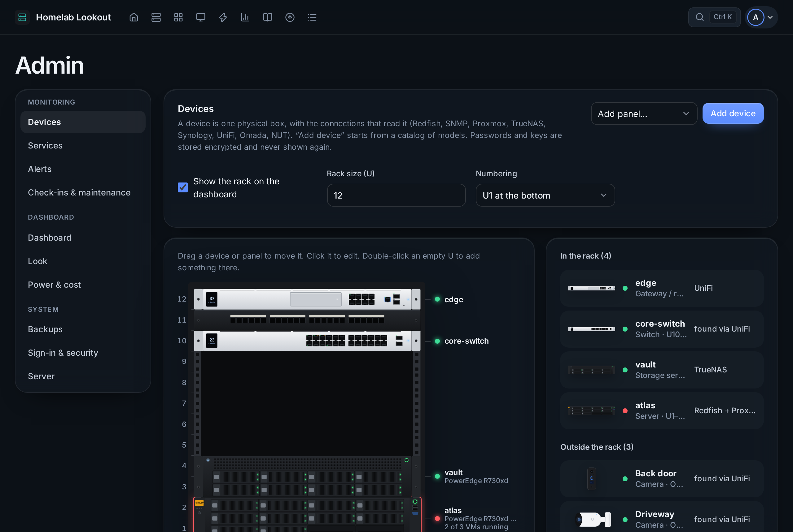
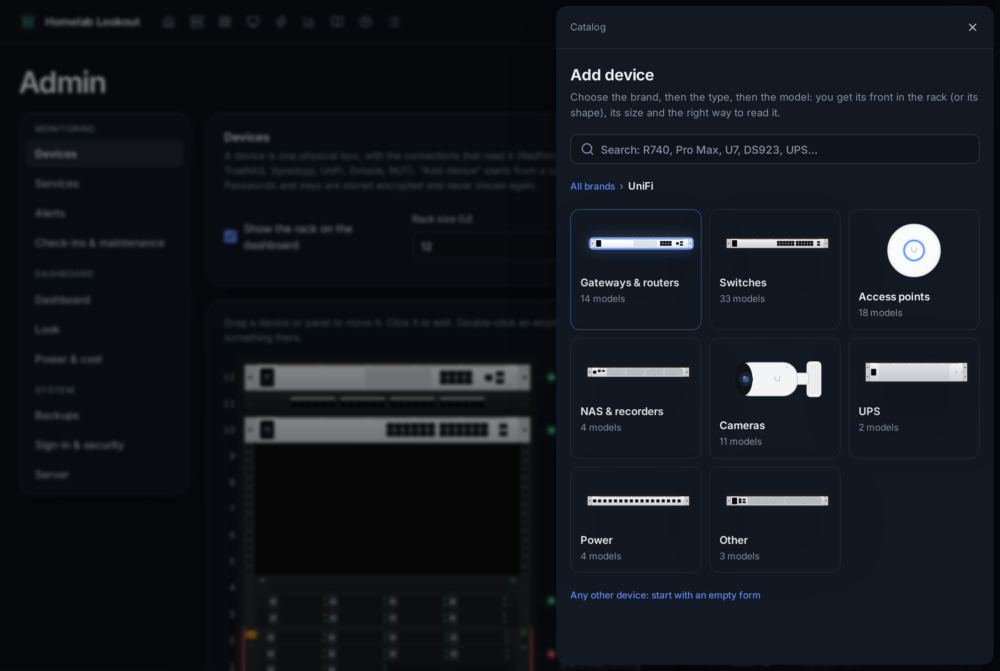
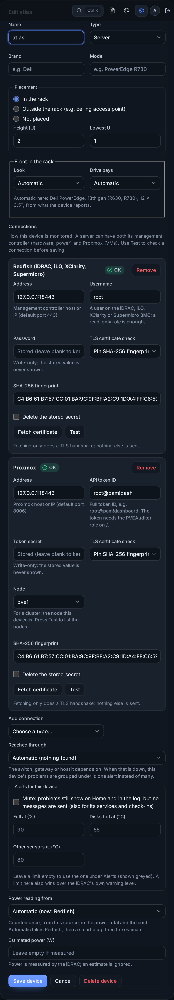
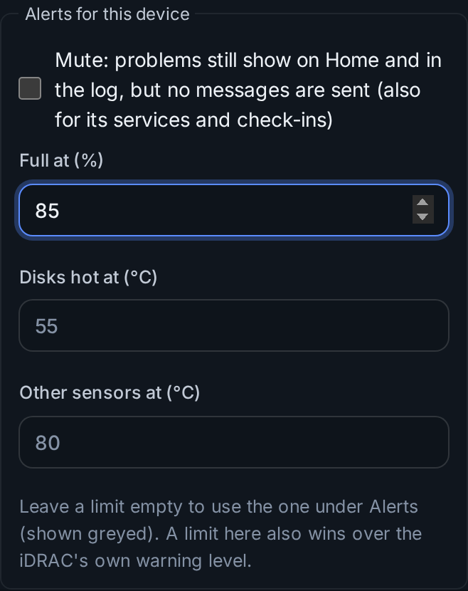

# Devices and connections

Everything is organised around **devices**: a server, a NAS, a switch, a UPS, a plug. A device has a name, a type, a place (in the rack, outside it, or not placed), and one or more **connections** that read it. A Proxmox server might have both its iDRAC (hardware, power) and Proxmox (VMs).



## Add a device from the catalog



**Admin → Devices → Add device** opens the catalog: choose the **brand**, then the **type**, then the **model** (search works from any step). About 180 models are drawn as they look: all of UniFi, Synology, QNAP, TrueNAS, Dell, HPE, Lenovo, Supermicro, Cisco, Aruba, MikroTik, TP-Link Omada, Netgear, APC, Eaton, CyberPower, Raspberry Pi and mini PCs. **Add this device** fills in the size, the front, drive bays, a typical power draw and the right connection; **Any other device** starts empty.

UniFi switches, access points and Protect cameras appear by themselves once the console is added. Deleting one of those hides it.

To find what is on your network, use [Find devices](find-devices.md).

## Connections

Use **read-only** accounts everywhere. Press **Test** before **Save device**.

| Connection | For | What to set up on the device |
|---|---|---|
| **Redfish** | Dell iDRAC, HPE iLO, Lenovo XClarity, Supermicro | A local user with a read-only role (*Read Only* on iDRAC, *Login* on iLO) |
| **Proxmox** | Proxmox VE | A user with the *PVEAuditor* role and an API token (below) |
| **TrueNAS** | TrueNAS 25.04+ | An API key for a user with *Read-only Administrator*; enter that user's name |
| **Synology** | Synology DSM | SNMPv3 (Control Panel → Terminal & SNMP): a user, SHA (or SHA-256) and AES; then **Fetch engine ID** |
| **UniFi** | UniFi OS consoles | A local *View Only* user without MFA (UniFi OS → Admins & Users); View Only for Protect too, for cameras |
| **SNMPv3** | Switches, routers, QNAP, UPS network cards | A read-only SNMPv3 user with SHA and AES; **Fetch engine ID** |
| **NUT** | A USB UPS | `upsd` listening on the network on the machine it is plugged into; the UPS name from `ups.conf` |
| **Omada** | TP-Link Omada | A local *Viewer* on the controller; after Test, pick which Omada device this is |
| **Shelly** / **Tasmota** | Smart plugs | Nothing (or the plug's web password). Only reads the power; never switches the plug |
| **Home Assistant** | Any power sensor HA reads | A long-lived access token and the sensor's entity ID (watts or kilowatts) |
| **Docker** | Containers on a Docker host | A read-only socket proxy (see [VMs and containers](vms-and-containers.md#docker-the-socket-proxy)) |
| **Portainer** | A Portainer environment | An access token and the environment ID |
| **Ping** | Anything without an API | Nothing; it only has to answer ping |

### Proxmox token

```sh
pveum user add dashboard@pve
pveum acl modify / --users dashboard@pve --roles PVEAuditor
pveum user token add dashboard@pve monitor --privsep 0
```

In the form, the user is the full token ID (`dashboard@pve!monitor`) and the secret is the token's UUID. To see **inside VMs** (filesystems, addresses, OS), install `qemu-guest-agent` in each VM, turn on *QEMU Guest Agent* in its Options, and allow the token to ask it (Proxmox 9):

```sh
pveum role add GuestAgentAudit --privs VM.GuestAgent.Audit
pveum acl modify /vms --users dashboard@pve --roles GuestAgentAudit
```

For backups on storages the token can't list, also give it *PVEDatastoreAuditor* on `/storage`.

### Self-signed certificates

Most devices have self-signed certificates. Choose **Pin SHA-256 fingerprint**, press **Fetch certificate**, and compare the fingerprint with the one the device shows if you can. The dashboard checks it **before** sending the password. If the certificate changes later (a firmware update), the device stops with *fingerprint mismatch; nothing was sent*: find out why, then fetch and save the new one.

### Secrets

Passwords, tokens and keys are entered only in Admin, stored encrypted, and never shown again: a form only says whether one is set. Changing a connection's address or user without typing the secret again deletes the stored one, so it is never sent somewhere new.



## Where it sits and how it looks

- **In the rack** with height and lowest U, **outside the rack** (a ceiling access point), or **not placed**.
- **Look** and **Drive bays** choose the drawing; *Automatic* picks from the model or what the device reports.
- A desktop NAS goes on a **shelf** in the rack.

## Power reading from

Each device's power comes from one source, so nothing is counted twice: *Automatic* (the controller, then a smart plug, then the estimate), one of those, or *Not counted* (for example when one plug feeds several devices). **Estimated power** is for devices without a sensor. See [Power and energy](energy.md).

## Reached through

Each device has **Reached through**: the switch, gateway or host it depends on. *Automatic* uses what UniFi reports (an access point hangs off its switch); choose it yourself for servers, or the Proxmox host for a device that is a VM. *Nothing* means reached directly.

When a device is down, everything behind it (devices, their services and check-ins) is grouped under it on Home, their tiles say **Unreachable**, and only one alert is sent, naming what is behind it ("also unreachable: atlas, Jellyfin…").

## Alerts for this device



- **Mute**: no messages for the device and its services and check-ins; problems still show, marked *Alerts muted*. For planned work, use a [maintenance window](checkins-and-maintenance.md) instead.
- **Full at**, **Disks hot at**, **Other sensors at**: limits for this device only; empty uses the general limits under Alerts. A limit here also wins over the iDRAC's own warning level.

A service has its own **Mute alerts** box.
