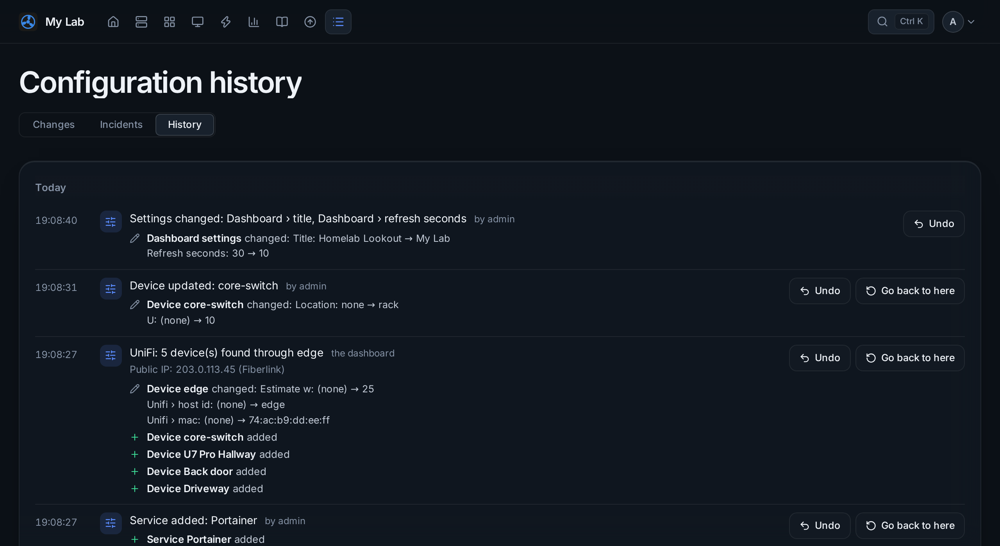

# Docs, Updates and Log

## Docs

Your documentation, edited in place:

- **Server sheets**: model, service tag, CPU and memory, disks, VMs, rack position, addresses and switch port fill in by themselves; **Edit notes** adds your own.
- **Network plan**: networks and IP reservations, importable from UniFi, plus the live client list.
- **Switch ports** and a **topology** diagram drawn from UniFi.
- **Pages**: your own pages in Markdown (`# heading`, `**bold**`, `- list`, `[link](https://…)`). **History** keeps the last 50 versions (saves within ten minutes count as one) with what changed and **Restore**. A deleted page goes to **Recently deleted** and can be restored with its history.
- **Edit menu** creates, renames and reorders groups and moves sheets and pages between them.

Docs always need a sign-in, even on a public dashboard. They are not for passwords: link to your password manager instead.

## Updates

One list of what can be updated, with the installed and the new version and release notes:

- Proxmox packages (pve-manager, kernel, QEMU…; read with the read-only token),
- TrueNAS and its apps, UniFi firmware, Synology DSM,
- Sonarr, Radarr, Lidarr, Prowlarr, Seerr, Pi-hole, Paperless-ngx, authentik, Portainer, Home Assistant, Tautulli, Plex and AdGuard Home,
- the packages waiting on each machine with a [Lookout agent](linux-agents.md), with security fixes and *reboot needed*,
- **Homelab Lookout itself**: a new release, with how many changes it brings, *What's new* from its release notes, and how to update the way it runs here (Docker or directly on Linux).

For Lookout's own updates, GitHub is asked once a day for the latest release of [Quant-0/homelab-lookout](https://github.com/Quant-0/homelab-lookout/releases), and GitHub compares it with the commit this dashboard was built from. A release with changes this one lacks is an update. A build that is the same or newer (like the `:edge` image) is up to date. GitHub sees the server's public address when it is asked; **Admin → Server** has a switch to turn the check off, and then nothing is sent.

It is checked every night at 04:00; **Check now** checks right away. **Nothing is ever installed from the dashboard**: update on the device itself, then press Check now. Home shows the count, and a device's details say *Update available*. Visitors to a public dashboard never see versions.

## Log

Everything that happens, newest first, grouped by day: every change in Admin and Docs (with what changed, *Title: Homelab → My Lab*, and who did it), devices found, problems starting and clearing, notifications sent, acknowledgements and snoozes, the public IP, patch cables, sign-ins and failed sign-ins, update checks, backups, network scans and restarts.

Filter by category, search, and **Download CSV**. Entries are kept for a year and go into backups. Passwords and keys are never written to it; at most it says that one was changed.

**Incidents** at the top of the Log: see [Alerts and incidents](alerts.md#incidents).

## Configuration history and undo

**History** at the top of the Log lists every change to the configuration, newest first: who made it, and what it changed, with before → after (*Device atlas changed: Name: atlas → atlas-2*). Each change has two buttons:

- **Undo** puts back only what that change touched, and leaves everything changed since alone. A deleted device comes back with its connections and their stored passwords. If something it touched was changed again later, it says what and when, and asks before overwriting it.
- **Go back to here** puts the whole configuration back as it was right after that change, by undoing every change made since.

An undo is a change of its own, so it can be undone too (undoing an undo is listed as *Redid*). Both ask for your password if you haven't typed it in the last 15 minutes.

What is in it: devices and their connections, services, alert rules and channels, check-ins, maintenance windows, agents, the rack and patch cables, the Home and wall layouts, and the dashboard, look, power and backup settings. Changes the dashboard makes itself (a device found by UniFi, a browser that turned push off) are there too, *by the dashboard*, and so are changes made to `config.json` while it wasn't running.

What is left out on purpose: the admin password, passkeys and sign-ins, the web server's ports and addresses (rolling those back could lock you out), uploaded images and the backup run log.

Versions are kept for 90 days (at most 500) in `config-history.json` in the data folder. Stored passwords stay encrypted in it, as in `config.json`, and are never shown or sent to the browser; at most it says a password changed. The history stays on the server and is not part of backups; restoring a backup is itself a version you can undo.
