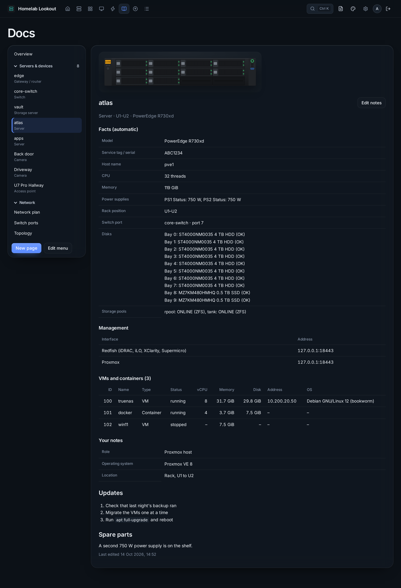
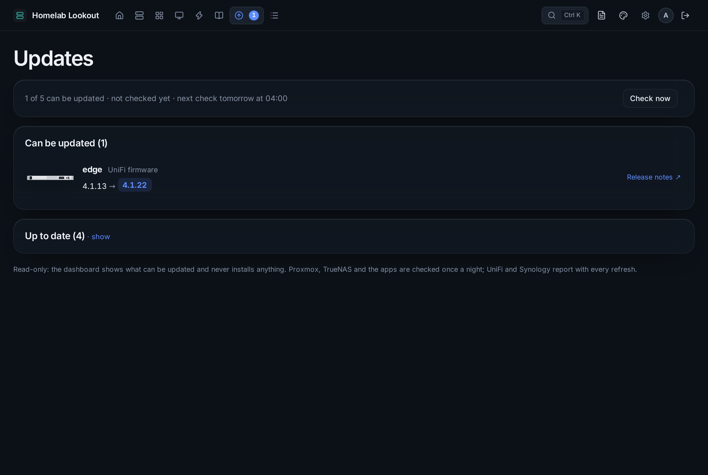
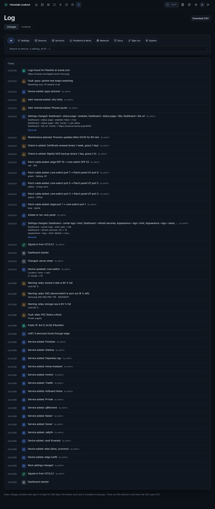

# Docs, Updates and Log

## Docs

Your documentation, edited in place:

- **Server sheets**: model, service tag, CPU and memory, disks, VMs, rack position, addresses and switch port fill in by themselves; **Edit notes** adds your own.
- **Network plan**: networks and IP reservations, importable from UniFi, plus the live client list.
- **Switch ports** and a **topology** diagram drawn from UniFi.
- **Pages**: your own pages in Markdown (`# heading`, `**bold**`, `- list`, `[link](https://…)`). **History** keeps the last 50 versions (saves within ten minutes count as one) with what changed and **Restore**. A deleted page goes to **Recently deleted** and can be restored with its history.
- **Edit menu** creates, renames and reorders groups and moves sheets and pages between them.

Docs always need a sign-in, even on a public dashboard. They are not for passwords: link to your password manager instead.

## Updates

One list of what can be updated, with the installed and the new version and release notes:

- Proxmox packages (pve-manager, kernel, QEMU…; read with the read-only token),
- TrueNAS and its apps, UniFi firmware, Synology DSM,
- Sonarr, Radarr, Lidarr, Prowlarr, Seerr, Pi-hole, Paperless-ngx, authentik, Portainer, Home Assistant, Tautulli, Plex and AdGuard Home,
- the packages waiting on each machine with a [Lookout agent](linux-agents.md), with security fixes and *reboot needed*.

It is checked every night at 04:00; **Check now** checks right away. **Nothing is ever installed from the dashboard**: update on the device itself, then press Check now. Home shows the count, and a device's details say *Update available*. Visitors to a public dashboard never see versions.

## Log

Everything that happens, newest first, grouped by day: every change in Admin and Docs (with what changed, *Title: Homelab → My Lab*, and who did it), devices found, problems starting and clearing, notifications sent, acknowledgements and snoozes, the public IP, patch cables, sign-ins and failed sign-ins, update checks, backups, network scans and restarts.

Filter by category, search, and **Download CSV**. Entries are kept for a year and go into backups. Passwords and keys are never written to it; at most it says that one was changed.

**Incidents** at the top of the Log: see [Alerts and incidents](alerts.md#incidents).
