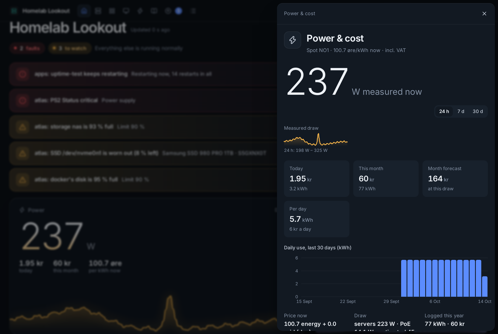
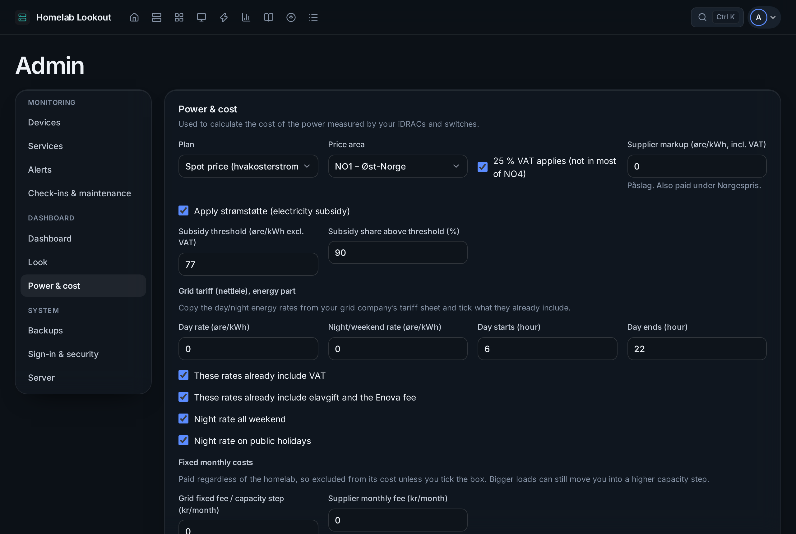
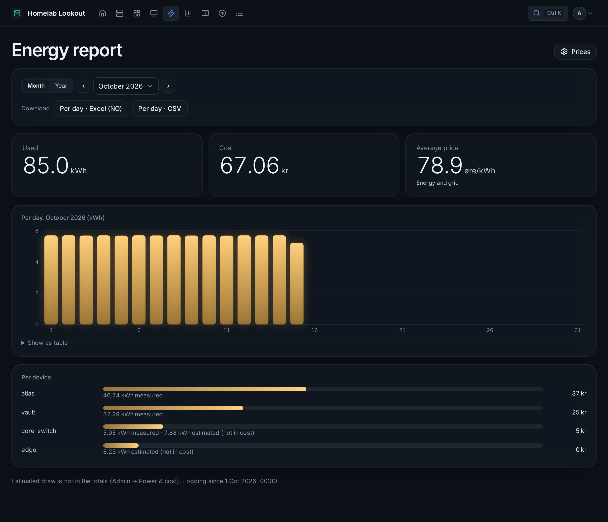

# Power and energy

## Where the power comes from

The dashboard adds up what your lab draws from:

- **management controllers** (Redfish: iDRAC, iLO, XClarity, Supermicro);
- **smart plugs**: Shelly, Tasmota, or any power sensor in Home Assistant;
- **UPSes** (load in watts, over NUT or SNMP);
- **PoE** that UniFi switches deliver (counted on the switch);
- **estimates** you enter for devices without a sensor.

Each device has one source (**Power reading from**: *Automatic* takes the controller, then a plug, then the estimate), so a server with both an iDRAC and a plug is never counted twice. Choose *Not counted* when one plug feeds several devices.

## Prices (Norway)

**Admin → Power & cost**:

- **Plan**: spot price for your price area (NO1–NO5, from [hvakosterstrommen.no](https://www.hvakosterstrommen.no/strompris-api)) with VAT, supplier markup and subsidy, or **Norgespris**.
- **Grid tariff**: day and night/weekend rates and when the day starts and ends, *elavgift*, the Enova fee and the fixed monthly costs (from your grid company's price page).
- **Include estimated power in cost**: whether estimates count, or only measured power.

Usage is logged per hour and priced at the time of use, so the cost is what the power actually cost, not today's price times the total.

## Prices in other countries

Choose **Another country or price** as the plan, then your **currency** and where the price comes from:

| Price from | What it is | Needs |
|---|---|---|
| **One fixed price** | The same price per kWh all the time | – |
| **Prices by time of day** | Peak and off-peak: periods with days and hours (a period that ends before it starts runs past midnight), tried from the top, and a price for other times | – |
| **Spot price in Europe (ENTSO-E)** | The day-ahead market price of your bidding zone (Sweden, Denmark, Finland, Germany, the Netherlands, France, Poland … 34 zones), every hour or 15 minutes. It comes in euro and is converted with the European Central Bank's daily rates | A free API key: register at transparency.entsoe.eu and ask transparency@entsoe.eu for "Restful API access" |
| **A Home Assistant sensor** | The price now from any integration you have there (Nord Pool, Tibber, Octopus, Amber …). Its unit tells whether it is per kWh, in cents or per MWh | The address, the sensor and a long-lived access token |
| **Tibber** | The price Tibber bills you, VAT and taxes included | A token from developer.tibber.com |
| **Octopus Agile** (UK) | The half-hourly Agile price for your region | – |

On top of the energy price: **VAT** in percent (added to market prices, and to what you enter unless *The amounts I enter here include VAT* is ticked), a **supplier markup**, **taxes and fees** per kWh, a **grid fee** (none, one rate, or by time of day) and the **fixed monthly costs**. All amounts are per kWh in your currency: 0.25 is 25 cents. The preview at the bottom adds them up, and says when a source can't be read.

The keys and tokens are kept encrypted and are never shown again. Days and times of day follow the **time zone** on the Dashboard tab (Europe/Oslo unless changed). Changing the currency doesn't convert what was logged before.

## The power card

On Home: the draw now with its graph, today's and this month's cost, and the price now. The details add the month's forecast, cost per day, the last 30 days and the yearly figures.

## Energy report

**Energy** in the top bar:

- **Month / Year**: a month by day, or a year by month; **‹ ›** and the menu step through periods.
- **Used**, **Cost** and **Average price**, compared with the period before.
- Point at a bar for that day; **Show as table** gives the same numbers as a table.
- **Per device**: how much each device used, measured and estimated.
- **Downloads**: *Excel (NO)* opens straight in Norwegian Excel (semicolons, decimal commas, æøå intact); *CSV* is for everything else (commas, decimal points). Per day for any period, per month for a year; each file ends with the per-device totals.
