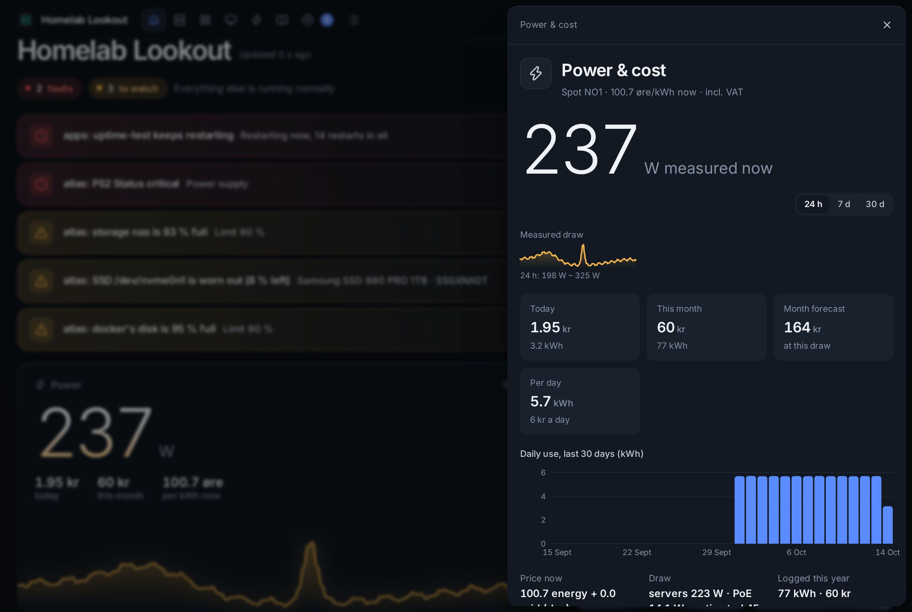
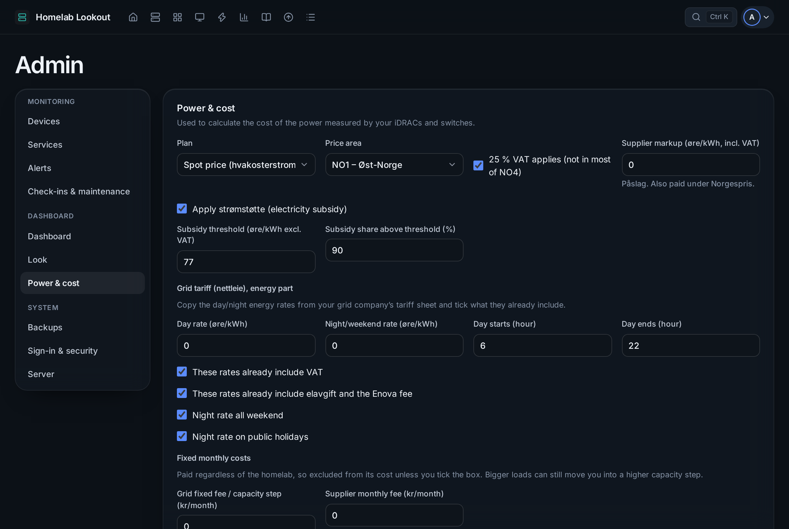
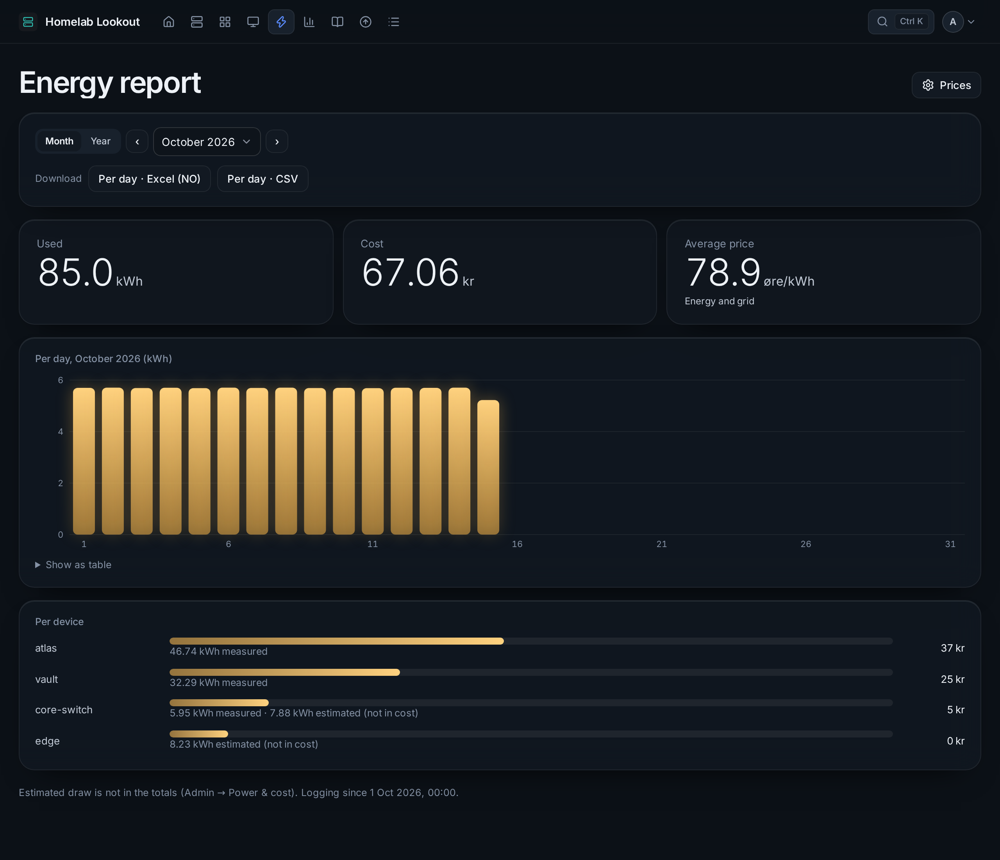

# Power and energy

## Where the power comes from

The dashboard adds up what your lab draws from:

- **management controllers** (Redfish: iDRAC, iLO, XClarity, Supermicro);
- **smart plugs**: Shelly, Tasmota, or any power sensor in Home Assistant;
- **UPSes** (load in watts, over NUT or SNMP);
- **PoE** that UniFi switches deliver (counted on the switch);
- **estimates** you enter for devices without a sensor.

Each device has one source (**Power reading from**: *Automatic* takes the controller, then a plug, then the estimate), so a server with both an iDRAC and a plug is never counted twice. Choose *Not counted* when one plug feeds several devices.

## Prices (Norway)

**Admin → Power & cost**:

- **Plan**: spot price for your price area (NO1–NO5, from [hvakosterstrommen.no](https://www.hvakosterstrommen.no/strompris-api)) with VAT, supplier markup and subsidy, or **Norgespris**.
- **Grid tariff**: day and night/weekend rates and when the day starts and ends, *elavgift*, the Enova fee and the fixed monthly costs (from your grid company's price page).
- **Include estimated power in cost**: whether estimates count, or only measured power.

Usage is logged per hour and priced at the time of use, so the cost is what the power actually cost, not today's price times the total.

## The power card

On Home: the draw now with its graph, today's and this month's cost, and the price now. The details add the month's forecast, cost per day, the last 30 days and the yearly figures.

## Energy report

**Energy** in the top bar:

- **Month / Year**: a month by day, or a year by month; **‹ ›** and the menu step through periods.
- **Used**, **Cost** and **Average price**, compared with the period before.
- Point at a bar for that day; **Show as table** gives the same numbers as a table.
- **Per device**: how much each device used, measured and estimated.
- **Downloads**: *Excel (NO)* opens straight in Norwegian Excel (semicolons, decimal commas, æøå intact); *CSV* is for everything else (commas, decimal points). Per day for any period, per month for a year; each file ends with the per-device totals.
