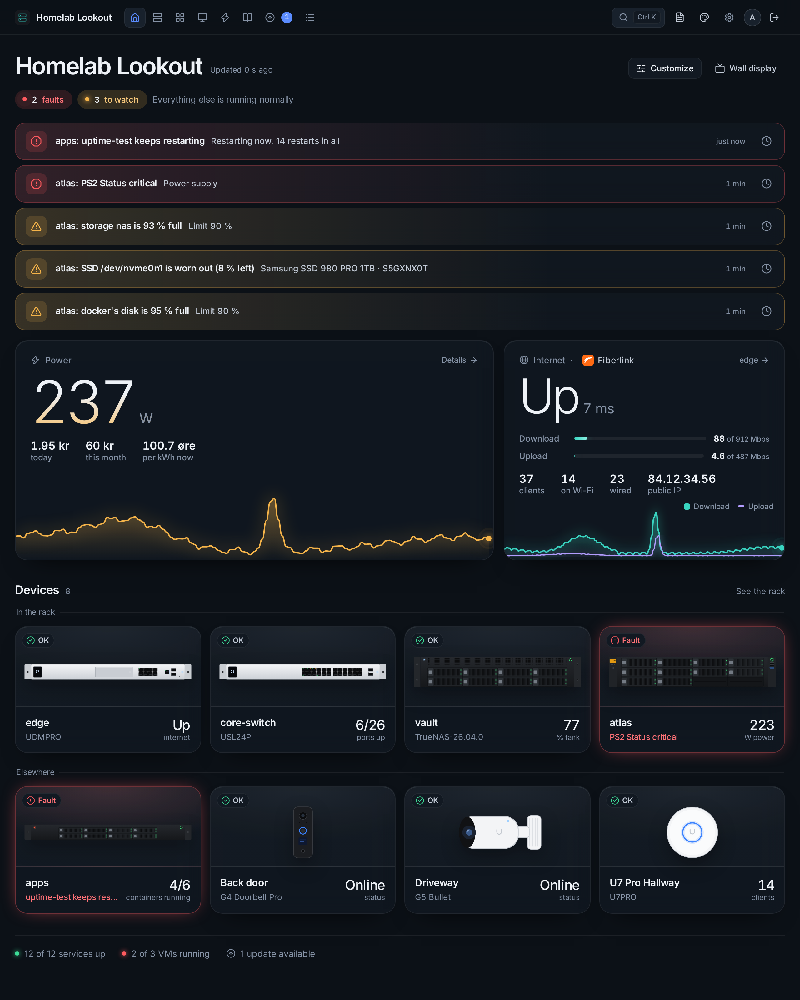
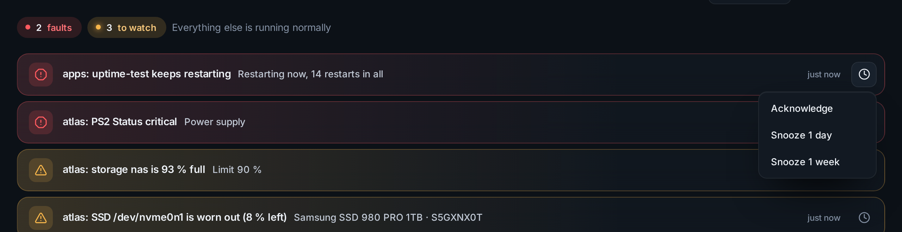
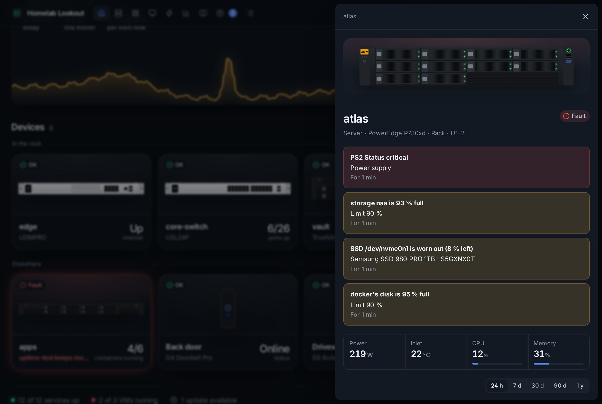
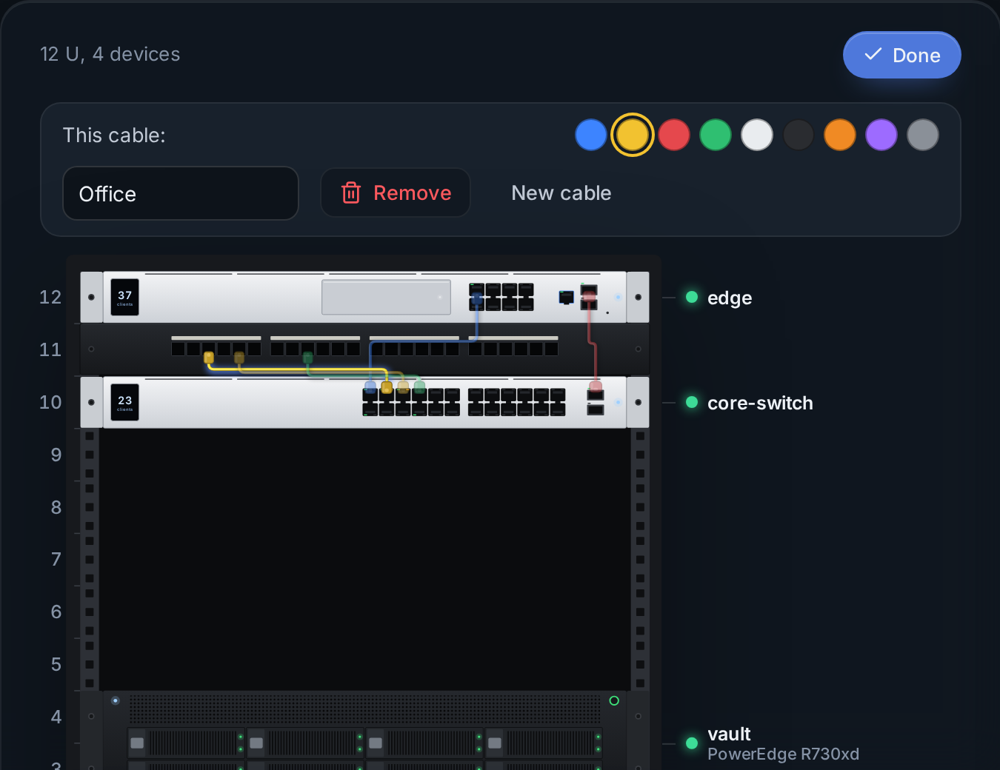
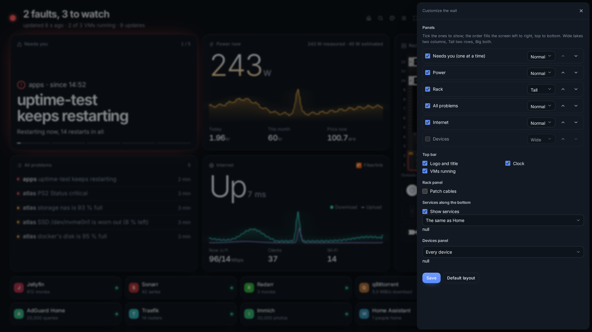
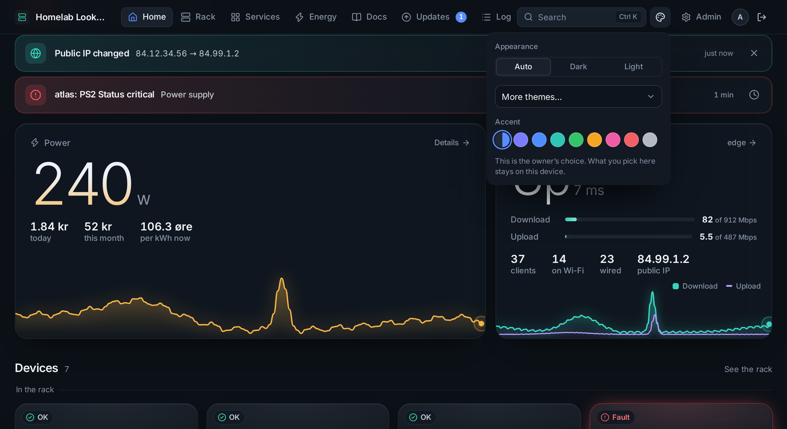

# Home, rack and wall display

## Home

Home answers one question: is everything all right?

- **At the top**: how many faults and things to watch, or *All normal*, and one line about the rest.
- **Needs you**: one row per problem, worst first, with how long it has lasted. Click a row to open the device. A connection that stops answering is listed after 2 minutes, so one slow reading doesn't raise an alarm. The same findings drive the [alerts](alerts.md).
- **Power** and **Internet**: two big cards with the number now and a graph of the last day. Power opens the details: today, this month, the month's forecast, cost per day and the year. Internet comes from the gateway (UniFi or Omada): up or down, traffic against your last speed test, clients, the provider with its logo, and the public IP (only when signed in).
- **Devices**: one tile per device, drawn as it looks, with one status (*OK*, *Warning*, *Fault*, *Offline*, *Unreachable* or *Maintenance*), its worst problem or its model, and one key number.
- **At the bottom**: services up, VMs running and updates waiting, each a link.

### The clock button on a problem

| | |
|---|---|
| **Acknowledge** | Someone is on it: the problem stays until it clears, but no more reminders are sent. The row says *Acknowledged by …* |
| **Snooze 1 day / 1 week** | Hides it from the top of Home and the wall display for everyone. The device still shows it and alerts are still sent; a warning that turns into a fault comes back by itself |

Rows may also say *Behind core-switch* (a device it depends on is down, see [Devices](devices.md#reached-through)), *Maintenance* (a [maintenance window](checkins-and-maintenance.md)) or *Alerts muted* (muted on the device or service).

When the public IP changes, a *Public IP changed* row appears (old → new) until an admin closes it.

### A device's details

Clicking a tile opens the details: its problems first, then its numbers and graphs, power supplies, fans, drives, ports, storage, VMs and containers, what is *filling up* and when it will be full, and for a machine with a [Lookout agent](linux-agents.md), what the agent reports. Buttons lead to its Docs sheet and to Admin.

### Customize

As admin, **Customize** on Home drags tiles into another order and hides the ones you don't want there (they stay in the rack and search). It is saved on the server, so it is the same everywhere. **Admin → Dashboard** chooses how services and VMs show on Home.

## Rack

The rack is drawn to scale (a 19″ front is 482.6 mm wide and 1 U is 44.45 mm), with fronts modelled on the real hardware and live lights: the drives your servers really have (amber when one is about to fail), switch ports lit by link and PoE, status LEDs. A device with a problem gets a red or amber outline.

- **Realistic / Schematic** switches between the drawing and plain blocks with names, status and power.
- Click a device for its details; on a wide screen they stand beside the rack.
- Devices outside the rack (access points, cameras) are listed below it.

Set the rack's size and numbering, and drag devices and panels, in **Admin → Devices**. Blank panels, patch panels, shelves and cable management are *passive items*: double-click an empty U to add one.

### Patch cables

**Cables** shows or hides the cables (off at first, remembered per browser). To draw them, sign in and press **Patch**: pick a colour, click a port on a switch, gateway or patch panel, then the port at the other end. Click a cable to change its colour, give it a label or remove it; **Done** leaves patch mode. Removing a device or panel from the rack removes its cables, and every change is in the Log.

## Wall display

`/wall` (or **Wall display** on Home) is one screen for a tablet or TV, readable across the room and never scrolling:

- the headline (*2 faults, 1 to watch* or *All systems normal*), your logo and title beside the clock;
- **Needs you**: one problem at a time, eight seconds each, with the full list beside it;
- power with its graph, the internet, the rack and the services.

The buttons fade out when nobody touches the screen. The full-screen button keeps the screen awake where the browser allows it. For a wall tablet, sign in once with *Remember this device for viewing*.

**Customize** (signed in) changes the wall for every screen: which panels show, their order and size (Normal, Wide, Tall, Big), the top bar, patch cables, and which services and devices. **Default layout** brings the original back.

## Search and your own look

Press **Ctrl K** or **/** anywhere to find devices, services, VMs, Docs sheets and pages (also the text in them), IP reservations and settings.

Your avatar (top right) has **Look on this device**: Auto, Dark, Light, 18 more themes and an accent colour, on this device only. Everyone else keeps the owner's look from **Admin → Look**.

On a phone, the tab bar at the bottom has Home, Rack, Services and Energy, and **More** has the rest.
