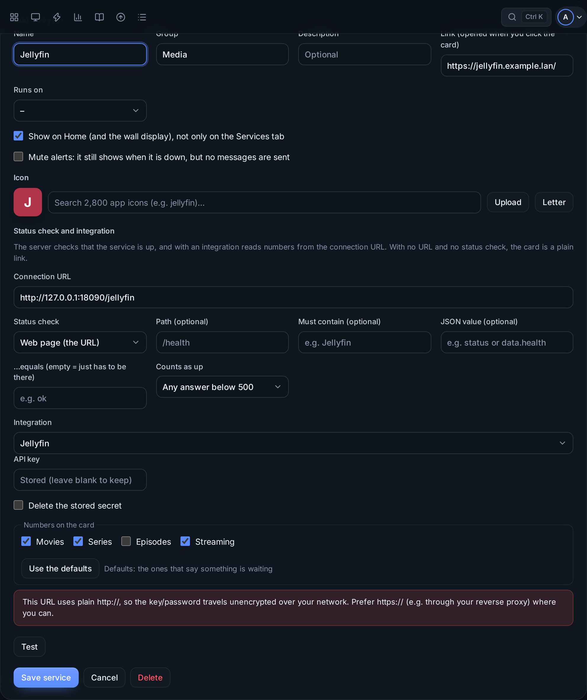
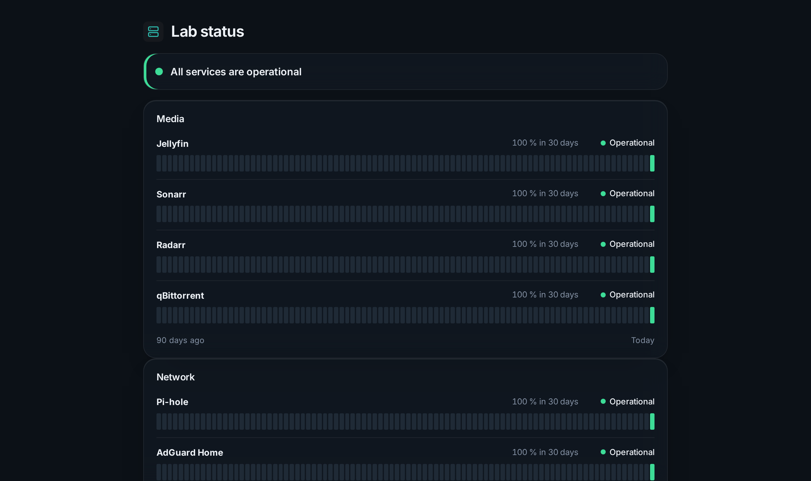

# Services and the status page

The **Services** page shows your apps in groups, each card with a status dot and up to four live numbers. Click a card to open the app.

## Adding a service

**Admin → Services → Add service**:

| Field | |
|---|---|
| Name, group, description | What shows on the card |
| Link | What opens when you click the card |
| Runs on | The device it runs on (for dependencies and muting) |
| Icon | Search about 2,800 app icons, upload your own, or use a letter |
| Connection URL | For the status check and the numbers; can be an internal address |
| Status check | How *up* is decided (below) |
| Integration and its key | Where the numbers come from |

Press **Test**, choose the **numbers on the card** (up to four), then **Save service**. Over plain `http://` a key travels unencrypted on your network; the form warns you.

**Mute alerts** keeps a service on the page and on Home but sends no messages for it. **Show on Home** decides whether it is on Home and the wall display.

## Status checks

| Check | Up when |
|---|---|
| **Web page** | The connection URL answers. Optionally a **path** (`/health`), a word it **must contain**, a **JSON value** (`status` = `ok`, `data.health`, `items[0].state`), and **only success** (2xx/3xx), so a login page or an error doesn't count |
| **Ping** | The host answers ping |
| **TCP port** | Something listens on the port (SSH on 22, a database on 5432) |
| **DNS lookup** | Your DNS server (Pi-hole, AdGuard) resolves a name, optionally to an expected address, so a DNS server that is up but broken is caught |

The response time is kept as history. For an `https://` service, the certificate's expiry is watched too: a warning two weeks before, critical the last three days.

## Integrations

34 apps: Jellyfin, Emby, Plex, Tautulli, Sonarr, Radarr, Lidarr, Prowlarr, Bazarr, Overseerr/Jellyseerr, qBittorrent, Transmission, SABnzbd, Pi-hole (v5/v6), AdGuard Home, Nginx Proxy Manager, Traefik, Home Assistant, Nextcloud, Immich, Paperless-ngx, Uptime Kuma, Grafana, Portainer, Speedtest Tracker, Prometheus, authentik, TrueNAS, Synology DSM, UniFi Network, UPS (NUT), PeaNUT, Tailscale and Proxmox VE, plus a **Custom JSON API** card for anything else.

Each integration shows the two or three numbers that say something is waiting for you (queued, wanted, streams, failed); pick others after a Test.

### Infrastructure cards

| Integration | Numbers from | Shows |
|---|---|---|
| Proxmox VE | A Proxmox device you added | VMs running, CPU, memory; the link opens Proxmox |
| TrueNAS | A TrueNAS device, or its own URL and key | Alerts, unhealthy pools, space |
| Synology DSM | A Synology device, or DSM's own login | Volume used, CPU, memory, temperature |
| UniFi Network | A UniFi console, or its own login | Clients, WAN, devices offline, speed test |
| UPS / PeaNUT | A UPS you added, a NUT server, or PeaNUT | Charge, runtime, load, on battery |
| Tailscale | A read-only API token | Devices online, keys about to expire |

With **Numbers from** set to a device, the card uses what the dashboard already reads: no second password is stored.

A **Portainer** card counts containers; **Show its containers** on the card adds Portainer as a connection, so each container shows on the [VMs page](vms-and-containers.md).

## Customize

**Customize** on the Services page (admin) drags services between groups, moves groups, renames them, sets the columns per group, and hides services.

## The status page

A public page at `/status` for the people who use your services: whether each one is up, its uptime over 90 days (30 on a phone), and planned maintenance. It shows no links, addresses, devices or VMs. Switch it on in **Admin → Dashboard → Status page**; it works while the dashboard itself stays private, so you can share it instead of the dashboard.
