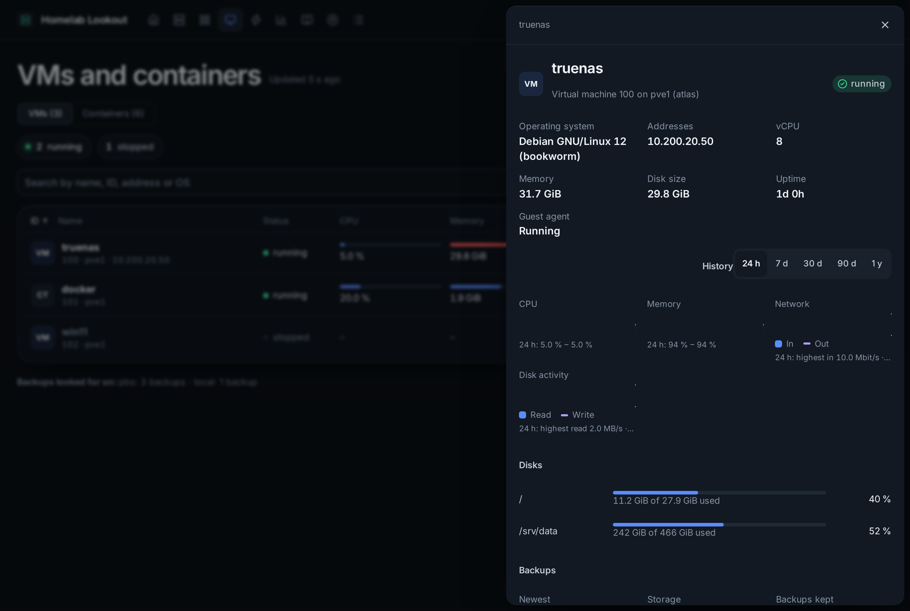
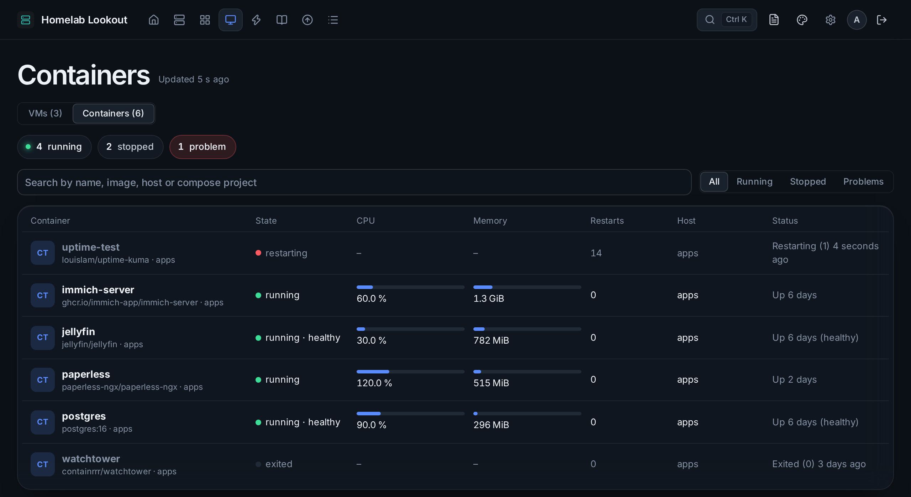

# VMs and containers


**VMs** in the top bar lists every VM and container on your Proxmox servers, and every Docker container, one row each.

## Proxmox guests

- **Status, CPU, memory, disk, network and last backup** per guest.
- **Filter**: All, Running, Stopped, or **Backup** (no backup, or one older than the limit). **Search** by name, ID, address or OS.
- **Sort** by clicking a column heading (by **ID** at first; again to turn it around). On a phone, the **Sort** menu. Remembered per browser.
- The disk is a container's own disk, or for a VM with the QEMU guest agent its fullest filesystem; the address comes from the guest agent too.
- With a [Lookout agent](linux-agents.md) inside, memory shows what Linux really uses (Proxmox counts the file cache as used, so VMs often look fuller than they are).
- **Settings** (top right) opens where VMs and containers are set up in Admin.



Click a row for the details: OS, addresses, size, graphs of CPU, memory, network and disk activity, every filesystem, the agent's data, the backups (newest, where, how many, verified), the **backup job** with its schedule, and **Open in Proxmox** (signed in).

### Backups

**Last backup** is the newest backup Proxmox has of the guest, on any backup storage (also Proxmox Backup Server). A guest is **overdue** when its newest backup is older than its backup job's interval plus a day (a monthly job allows 32 days, a weekly one 8); a guest in no job uses the limit under *Admin → Alerts → Backup failed* (35 days by default). Overdue raises a *Backup failed* warning. A guest that has never been backed up is shown, not alerted. Under the list, **Backups looked for on** names every backup storage and what it held.

If the token can't list a storage's files, the times are read from the backup jobs' logs instead; give the token *PVEDatastoreAuditor* to read the files themselves.

## Containers



The **Containers** view lists the containers from your Docker hosts and Portainer environments: state, health, CPU (100 % is one core), memory, restarts and Docker's own status, with history graphs.

Problems become **Container problem** alerts: a container that **keeps restarting**, one that **stopped** although its restart policy says it should run (a stop by hand, exit code 137 or 143, doesn't count), or one that fails its own **health check**. Add the label `lookout.ignore=true` to leave a container out.

A VM whose address matches a Docker host lists its containers in its details.

### Docker: the socket proxy

The Docker API can do everything on a host, and a container's settings often hold passwords. So the dashboard never gets the Docker socket itself: a small proxy on each Docker host answers only *list containers*, *inspect* and *stats*.

On the Docker host:

```yaml
services:
  socket-proxy:
    image: tecnativa/docker-socket-proxy:latest
    restart: unless-stopped
    environment:
      CONTAINERS: 1   # read containers, inspect and stats
      POST: 0         # nothing can be changed
    volumes:
      - /var/run/docker.sock:/var/run/docker.sock:ro
    ports:
      - "192.168.1.30:2375:2375"   # this host's own address
```

Ports published by Docker bypass `ufw`, so let only the dashboard in with Docker's own firewall chain (and save it with `iptables-persistent`):

```sh
sudo iptables -I DOCKER-USER -p tcp -m conntrack --ctorigdstport 2375 --ctdir ORIGINAL ! -s 192.168.1.20 -j DROP
```

Then add a **Docker** connection to the device (address `192.168.1.30:2375`). From *inspect*, only state, health, restarts, exit code and restart policy are used; the environment is never kept or passed on.

### Portainer

Add a **Portainer** connection: Portainer's URL (`https://192.168.1.30:9443`), the **environment ID** (empty for the first) and an **access token** (your user → Access tokens). In Portainer Community a token can also change things, so keep it only here. A Portainer *service card* can do this for you with **Show its containers**.
