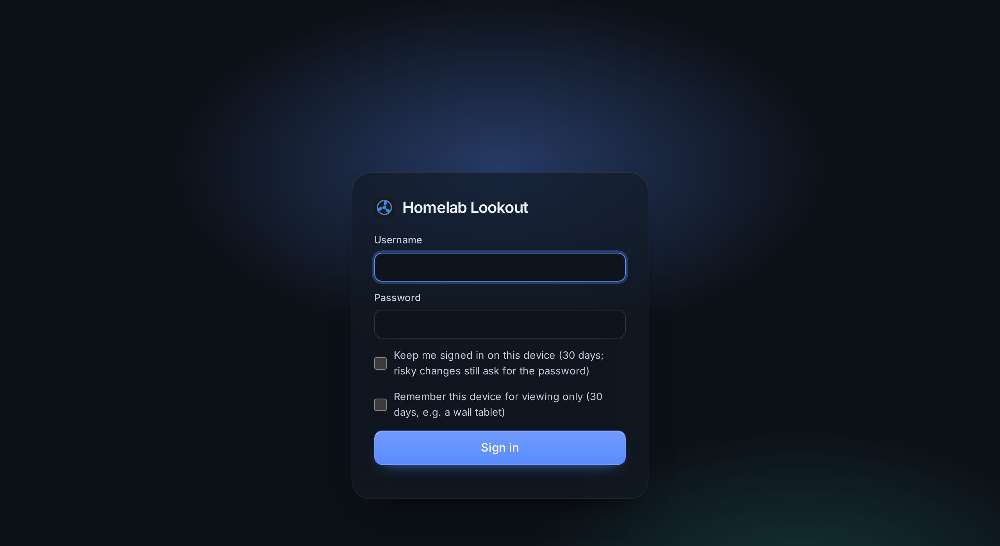

# First steps

After [installing](installation.md):

- **Directly on Linux:** the installer asked for the admin account; sign in with it.
- **With Docker:** the first page is **Create the admin account**. It asks for the setup code from the container's log (Portainer: the container → *Logs*, or `docker logs lookout`). See [the first start](install-docker.md#3-the-first-start).

## Trust the certificate (once per device)

The dashboard uses its own small certificate authority. Until a device trusts it, the browser warns, and phones won't offer to install the app.

1. Download the CA from `https://YOUR-SERVER-IP:8443/ca.crt`, or **Admin → Server → Download CA certificate**.
2. Check its fingerprint against the one the installer printed (with Docker: the one in the container's log), or the one under **Admin → Server → Certificate** on a device you already trust.
3. Import it:

| Device | How |
|---|---|
| iPhone / iPad | Open the file → Settings → *Profile Downloaded* → Install. Then Settings → General → About → **Certificate Trust Settings** → turn it on |
| Android | Settings → Security → Encryption & credentials → Install a certificate → **CA certificate** |
| Windows | Double-click → Install Certificate → Local Machine → *Trusted Root Certification Authorities* |
| macOS | Double-click → Keychain Access (System) → open the certificate → Trust → *Always Trust* |
| Linux | Copy to `/usr/local/share/ca-certificates/` and run `sudo update-ca-certificates`; in Firefox: Settings → Certificates → Import |

The CA is *name-constrained*: it can only vouch for this server's addresses and names, never for other websites.

> Behind a reverse proxy with a public certificate (Let's Encrypt), you can skip this. See [Reverse proxy](reverse-proxy.md).

## Sign in

- A normal sign-in lasts **12 hours** (2 hours without use).
- **Keep me signed in on this device**: 30 days, ending after a week without use. Restarts and updates don't sign you out.
- **Remember this device for viewing only**: for a wall tablet. For 30 days it can look at every page, but never change anything.
- After 5 wrong passwords from an address it has to wait 30 seconds, doubling up to an hour; after 20 failures from anywhere, everyone waits.
- A few **risky changes** ask for the password again if it wasn't typed in the last 15 minutes: backups and backup destinations, alert channels, the web server, the dashboard address and reverse proxies, and making the dashboard or the status page public.

**Admin → Sign-in & security** lists every browser that is signed in (with *Sign out* and *Sign out everywhere else*) and every remembered device.

## Passkeys

Sign in with Face ID, Touch ID, Windows Hello or a security key instead of typing the password; the password keeps working.

1. Set a **Dashboard address** with a domain name in **Admin → Server** (passkeys belong to a name, never to an IP address).
2. Open the dashboard on that address and go to **Admin → Sign-in & security → Passkeys → Add a passkey**.
3. Give it a name (which phone or key it is on) and confirm.

The sign-in page then has **Sign in with a passkey**, and the *confirm your password* dialog offers **Use a passkey**. On the IP address, the sign-in page says where passkeys work.

## Install it as an app

1. Trust the certificate first (or use a domain name with a public certificate).
2. **Android (Chrome):** menu ⋮ → **Install app**. **iPhone (Safari):** Share → **Add to Home Screen**. **PC (Chrome, Edge):** the install icon at the end of the address bar.
3. Open the app and sign in with *Keep me signed in*. On an iPhone, sign in *inside* the app: home-screen apps don't share Safari's sign-in.

The app icon is your logo (Admin → Look). When the dashboard can't be reached, the app shows *Can't reach the dashboard* and opens by itself when it is back. Nothing from the dashboard is stored on the phone except that screen.

To get alerts as notifications on the phone, turn on **push** in the app: see [Alerts](../features/alerts.md#push-to-the-app).

## Next

- Add devices: **Admin → Devices → Add device**, or let [Find devices](../features/find-devices.md) look for them.
- Add your apps as [services](../features/services.md).
- Set up [alerts](../features/alerts.md).
